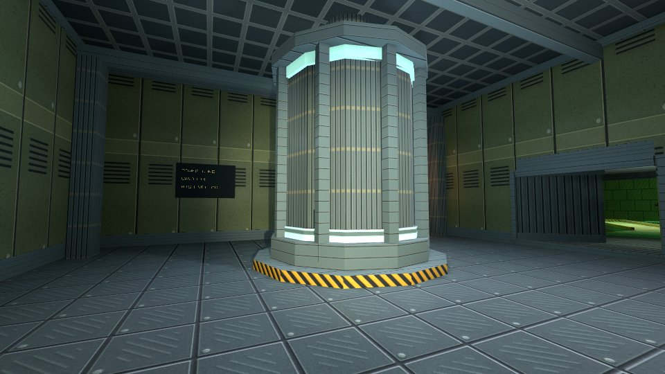
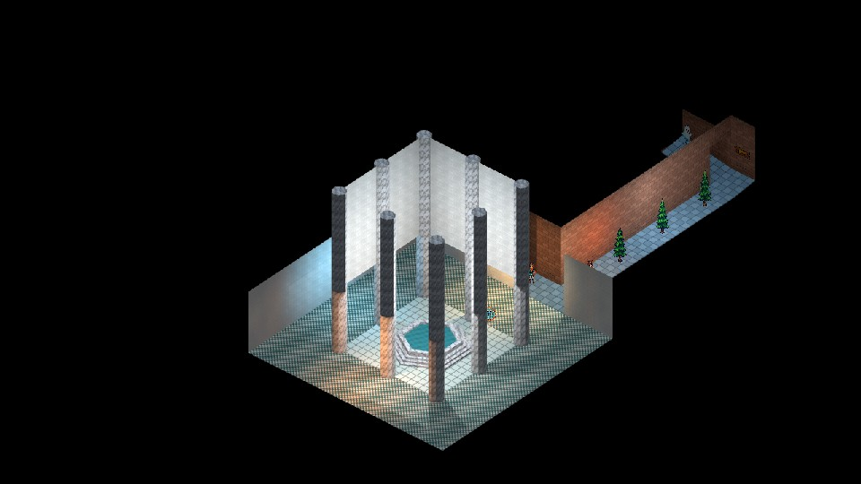

# Karty

**Start building Go games in minutes.**

- Make 2.5D retro shooters and isometric action RPGs.
- Stack 2D shapes into worlds without learning Blender.
- Create, preview, and package your game with one CLI.
- Build one kartridge. Run it on the web, Linux, macOS, or Windows.
- Built on [Ebitengine](https://ebitengine.org/) and [EbitenUI](https://github.com/ebitenui/ebitenui).

| First-person Hangar                                                                                                                       | Isometric Roman court                                                                                                                                                    |
| ----------------------------------------------------------------------------------------------------------------------------------------- | ------------------------------------------------------------------------------------------------------------------------------------------------------------------------ |
|  |  |

## Explore Karty

- [Play the demos](https://karty-game.github.io/karty/main/)
- [Read the game guide](docs/guide-generator.md)
- [Browse sample code](samples/README.md)
- [CLI docs and reference](docs/README.md)
- [Supported platforms and publishing](docs/distribution.md)
- [KartUI](https://github.com/karty-game/karty-ui) and [SDK](https://github.com/karty-game/karty-sdk)
- [MIT source license](LICENSE.md) and [runtime license](https://github.com/karty-game/karty-sdk/blob/main/RUNTIME_LICENSE.md)
