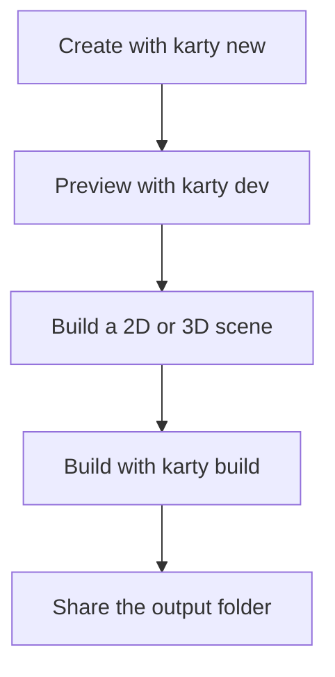

## Start with a playable game

Install the [Karty CLI](https://github.com/karty-game/karty/releases/latest), then run:

```sh
karty new my-game
cd my-game
karty dev
```

Open the address printed by the preview. Change a color or a movement speed in
`src/main.go`, save, and try it again. The first setup downloads tools; later
builds reuse them.



Keep `karty.toml`, your Go source, and source assets in Git. The CLI recreates
`.karty/` and `dist/`. Your project pins an exact SDK; use its `.karty/docs/`
reference for API names and supported features.

Make one small game rule work before adding more art: collect an item, reach a
goal, or restart after losing. For a 3D game, use the camera and loading code
from [Roman court & galleries](../world-camera/) as your starting point.
