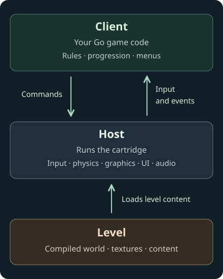

# Architecture

A Karty game has three main parts: a client containing your game code, levels
containing authored content, and a host that runs and presents the game.
The CLI builds the files that bring them together.

## The client contains the game rules

The client is your game's Go program. It decides what happens when a player
presses a button, which level to load, how the score changes and when to show
a menu. Here, client means game code on both desktop and web; it does not imply
a network connection or multiplayer server.

The CLI compiles that code to WebAssembly and packages it in `game.kart`, the
cartridge. Karty generates the game API your code calls.
Your game requests actions through that API and handles updates and events
from the host.

## The host provides the engine

The host runs the cartridge and provides input, entities, collision and physics,
rendering, UI presentation and media playback. It validates commands before
applying them and owns the runtime resources they create.

For example, your client proposes a character movement. The host resolves it
against the world and returns the accepted transform. Your next movement starts
from that accepted position. Game rules remain in your code; the host keeps the
world and its presented state consistent.

Native releases include a platform host executable. Web releases use a
WebAssembly host and browser support files. Karty prepares the matching game
bindings and runtime files automatically. Read [Build and preview](workflow.html)
to create a project and package it for players.

## A level groups content and its lifetime

A level starts with `level.toml` and its declared sources: a world, textures,
actors and other level content. Building turns those sources into a versioned
level file and any required sidecars.

Your client chooses when to load, mount and release a level. Mounting makes its
content available to the running game. Cameras, actors and other level-owned
resources depend on that mounted level; releasing it also releases its dependents.
A level is content managed by the host, rather than another running program.

## From an edit to a running game

The CLI resolves packages, processes assets, compiles the client and levels,
and stages the result with a compatible host. `karty dev` repeats that work as
you edit, then publishes a compatible resource update or reloads the preview.

The [asset pipeline](asset-pipeline.html) explains those build steps.
The [interaction guide](../guide/interactions.html) shows how game code connects
to authored content. Your project's `.karty/docs/` defines the exact lifecycle
and game API.
