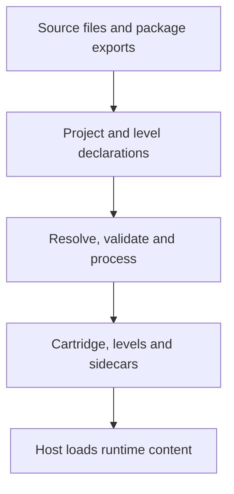
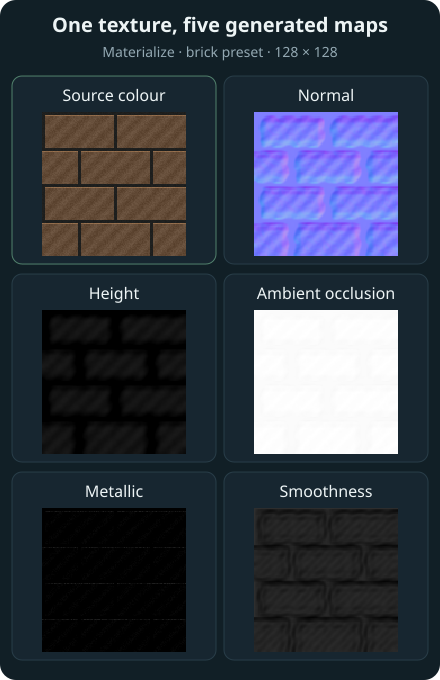

# Asset pipeline

Keep the files you author. Let Karty build the files the host needs.
A PNG, WAV, world YAML file or KartUI component is a source asset; the runtime
loads the processed result.



## Declarations give assets a place in the game

`karty.toml` selects the SDK and declares project assets. Each level's
`level.toml` selects its world source and resources. Logical asset names connect
those declarations to game code and authored content.

For example, a world material can start as `surface.png`. A level declares the
texture and its processing profile, then refers to its name from world YAML.
Moving the original image does not require changing every surface; update its
source declaration instead.

## Builds prepare runtime content

The [selected SDK](sdk-and-toolchain.html) defines processing profiles and pins required tools.
The CLI applies those profiles and any supported overrides, validates the
result, and caches it for later builds. Changing an input or processing recipe
selects a new cached result.

Images become runtime textures. Audio is converted for effects or streaming.
World sources become compiled geometry and resource descriptions. Material
generation and offline light baking prepare work that would otherwise happen
while the game runs. KartUI compiles authored components into the game's UI
bindings and packaged presentation data.

Each asset follows the processing it needs. An interface image, a world material
and a music track do not all use the same recipe.

## Materialize turns colour into surface detail

A colour image tells the renderer what a wall looks like, but it does not
describe which way its small ridges face or how shiny its surface is. Without
that information, a painted brick pattern can still look flat when a light
moves across it.

Materialize estimates those properties from your image. Karty uses it during
world material builds so you can start with one texture and a preset, rather
than authoring every map separately.



| Map                               | What the host uses it for                                                           |
| --------------------------------- | ----------------------------------------------------------------------------------- |
| Source colour, also called albedo | The painted colour of the surface                                                   |
| Normal                            | Changes the local lighting direction so ridges and recesses catch light differently |
| Height                            | Adds bounded, view-dependent relief to the texture                                  |
| Ambient occlusion, or AO          | Dims ambient light in estimated small crevices                                      |
| Metallic                          | Controls the material's metallic reflectance                                        |
| Smoothness                        | Controls how concentrated the reflected highlights appear                           |

Metallic and smoothness maps require an SDK with material reflectance support.
Older atlas-capable SDKs use normal, height and AO. These maps change shading;
they do not add geometry, change the wall's silhouette or create collision.

### Choose a material preset

For a world surface, declare the source and its Materialize preset in
`level.toml`:

```toml
[[textures]]
name = "brick"
source = "brick.png"
profile = "environment"

[textures.materialize]
preset = "brick"
```

Then build through the CLI:

```sh
karty build --target web
```

Use a preset that matches the surface, such as `brick`, `wood` or `metal`.
The image profile controls ordinary texture processing; the Materialize preset
controls map generation. Both contribute to the processing recipe.

The generated maps are estimates, so review the result under the game's
lighting. A dark painted mark or a shadow already in the source can be mistaken
for a recess. A preset is a starting point, and a material named `metal` does
not make painted areas physically metallic by itself.

### Do the expensive work before the game runs

The world pipeline normalizes each surface material to a 256-pixel tile and
runs the SDK-pinned Materialize executable for each uncached material. The
illustration above shows the original 128-pixel image and standalone native map
outputs; the game build also performs normalization and packaging.

Karty validates the generated maps, packs their channels into material atlases,
and builds smaller texture levels, called mipmaps, with borders that keep
neighbouring materials from bleeding into each other. The host loads those
prepared textures and samples them while drawing. It never runs Materialize
on a player's machine.

World materials use the packaged atlas directly. The build omits their individual
texture payloads when they have no separate sprite, animation, particle,
vegetation or level UI use. This also avoids decoding those duplicate images and
packing an unused sprite atlas at runtime. Textures outside the material atlas
remain available as standalone level assets.

A cold build does more work. Later builds reuse maps whose source, preset,
generation settings and tool identity still match. Changing one material
regenerates that material and repacks the atlas; unchanged maps are reused.
The separate `textures.material_strengths` settings adjust how strongly the
host displays normal, height and AO effects while reusing the generated maps.

The [texture guide](../guide/textures.html) covers presets and surface mapping.
The generated `.karty/docs/` reference lists the controls supported by your SDK.

## Generated files have separate homes

| Location                     | Purpose                                                                          | Keep in Git |
| ---------------------------- | -------------------------------------------------------------------------------- | ----------- |
| Source folders and manifests | Go, KartUI, world sources, original media and configuration                      | Yes         |
| `packages/`                  | Fixed package archives referenced by the project                                 | Yes         |
| `.karty/`                    | Generated bindings, installed package views, processing caches and SDK reference | No          |
| `dist/`                      | Packaged output for the selected target                                          | No          |

Edit the original files and rebuild. A clean checkout can recreate generated
output from the committed sources and declared dependencies. Linked package
folders must also be available; use archives when you need a fixed copy.

## Shipping includes more than the cartridge

`game.kart` carries the client and embedded content. Levels and streaming
resources can live beside it. The native output includes its host; web output
includes the launcher and either local runtime files or verified shared-runtime
references, according to the build options.

Share the complete target directory so those pieces stay together.
Follow [Build and share](../guide/share.html) for packaging commands,
or [Textures](../guide/textures.html) for a world material example. Your project's `.karty/docs/` records its SDK's contracts.

## Source formats and runtime data

TOML configures projects and tools; YAML describes worlds and prefabs. Importers
may also consume editor formats such as Tiled JSON. Builds convert game data
into bounded binary resources before cartridge compilation. Runtime game code
uses the compiled records, with no general JSON, CSV, XML, gob or YAML/TOML
decoder dependency. Development-server messages, source-package inventories,
editor schemas and authoring reports remain tooling formats.

SDK 0.0.16 packs game images and all remaining level images into
build-time QOI atlas pages with a binary region layout (`texture/atlas@1`).
Sprites, UI, animation, particles and vegetation keep stable logical references
and original dimensions. Identical processed images share one rectangle;
connected particle frames share one page. The verified cache includes source
bytes, names, frame groups and packing revision. Reports count emitted page
bytes and decoded memory once, and retain source records for inspection.
Runtime loads the prepared pages and views; it does not rebuild these atlases.
