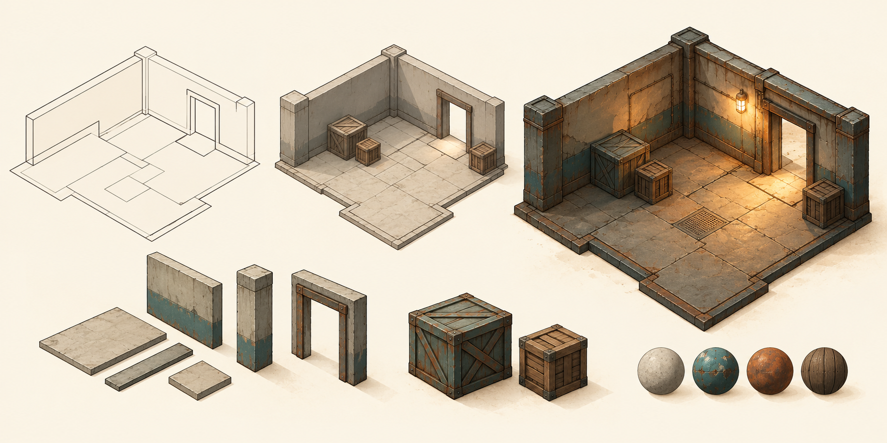

# Why Karty?

I started Karty to make the engine and framework I wanted to use myself:
write game rules in Go, build a room from simple shapes, and try it quickly.

## Make a room and try it

Unity and Unreal feel too big, too slow, and too general-purpose for my games.
I miss the directness of Doom and Half-Life level editors. Making a room and
trying it felt simple.

Karty is aimed at small games and prototypes, including retro first-person
games, isometric adventures and 2D games. For worlds, I want to work with
floor plans, heights, materials and reusable objects. That should be enough
to make a space worth exploring without first learning a full 3D modeling tool.

## Let the tools do the routine work

I want to supply an albedo image and let the tools generate the material maps.
I want to place lights and objects without spending hours tuning mipmaps or
packing lightmaps. Those jobs belong in the [asset pipeline](asset-pipeline.html).

Karty already processes assets during builds, generates world materials and
supports offline light baking. The project keeps the original files; derived
files can be rebuilt.

I also want to reuse behavior, effects and UI across games.
[Packages](packages.html) already share Go code, static prefabs, PNG materials
and KartUI components. A broader library of effects and components is still a goal.

## Keep the feedback loop short

Today, levels are authored in files and `karty dev` watches for changes.
Compatible lighting, material and global UI updates can reach the running
preview without resetting the game. Code and structural changes reload it.

The editor I want goes further: move a wall, swap a material or place an object
and see the result immediately. That graphical editing workflow is a direction
for Karty, rather than a feature available today.

## Choose a focused framework

Karty makes choices about world geometry, asset processing and the
[host and client boundary](architecture.html). Those choices reduce setup for
the games it targets, while limiting how much of the renderer or runtime a game
can replace. A game that needs an arbitrary mesh workflow or a custom rendering
pipeline may fit another engine better.

I'm building toward a workflow where making a small game that looks good takes
less preparation and leaves more time for the game itself.

Continue with [Architecture](architecture.html), or [make your first game](../guide/index.html).
