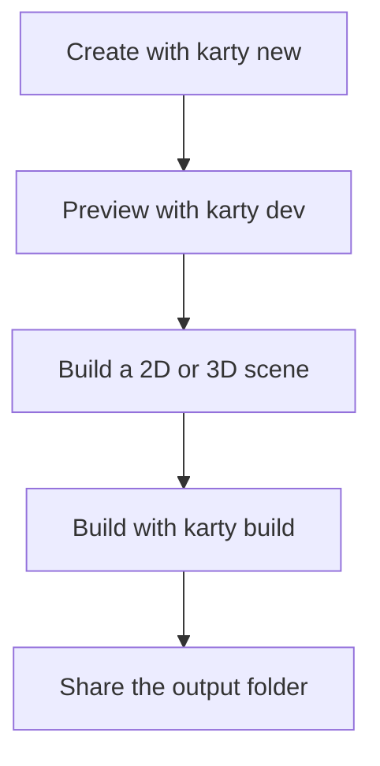

# Make a game with Karty

Create a project, choose a 2D or 3D scene, and add an interaction you can play.

## Start with a playable game

Install the [Karty CLI](https://github.com/karty-game/karty/releases/latest), then run:

```sh
karty new my-game
cd my-game
karty dev
```

The terminal wizard offers `blank`, `2d`, `fps`, `isometric`, and `ui`, plus optional
Git initialization and GitHub Actions. Use `--yes --template 2d` for scripts.
Use `--no-template` for just the base folders and an empty entry point.
Current starters use SDK 0.0.13, which the CLI installs when needed.

The SDK 0.0.13 2D, first-person and isometric starters use one reusable
controllers package with different presets. They include its source under
`packages/controllers/` so generated projects work without a published module.
Keep that folder in Git. Blank and UI projects add controls only when needed.

Open the address printed by the preview. Change a color or a movement speed in
`src/main.go`, save, and try it again. The first setup downloads tools; later
builds reuse them.



Keep `karty.toml`, your Go source, and source assets in Git. The CLI recreates
`.karty/` and `dist/`. Your project pins an exact SDK; use its `.karty/docs/`
reference for API names and supported features.

Make one small game rule work before adding more art: collect an item, reach a
goal, or restart after losing. For a 3D game, choose the first-person or isometric starter, then extend its
room using the matching guide path. [Roman court & galleries](../world-camera/)
shows how those camera views work in a larger world.

## Build one room

A level has a manifest, world geometry, and its own textures. Create
`levels/room/`, add a tileable `surface.png`, and save this as `level.toml`:

```toml
[level]
name = "levels.room"
kind = "world"

[world]
source = "world.yaml"

[[textures]]
name = "surface"
source = "surface.png"
profile = "environment"
```

Save this as `world.yaml`. X/Y describe the floor plan; Z is height. These
coordinates make an eight-metre square room with a three-metre ceiling.

```yaml
version: 19
rooms:
  - id: room
    rect: {width: 8, depth: 8, material: surface}
    floor: {c: 0}
    ceiling: {c: 3}
    floor_material: surface
    ceiling_material: surface
```

The build expands `rect` into four counterclockwise edges named `south`, `east`,
`north` and `west`. Use those names for connections. For an irregular room or
individual wall settings, use an explicit `boundary` instead of `rect`.
Run `karty schema` for editor suggestions, or `karty schema --check` to check
the world before processing assets.

Replace `src/main.go` with this room viewer. Change the import if your project
has a different name. The camera starts at `(2, 2, 1.7)`; the text shows loading
errors above the scene.

```go
package main

import "example.com/my-game/.karty/engine"

type Game struct {
    engine.Game
    request engine.RequestID
    camera *engine.EntityCamera3D
    label *engine.EntityText2D
}

//go:wasmexport karty_register
func main() {
    game := &Game{}
    engine.Run(engine.Hooks{
        OnStart: func() {
            game.label = game.NewText2D("Loading room...", engine.NewVec2(24, 24))
            game.request = game.RequestLevel("levels.room")
        },
        OnLevelReady: func(event engine.LevelReady) {
            if event.RequestID != game.request { return }
            game.camera = game.NewCamera3D(event.Handle, engine.CameraSettings{
                Projection: engine.CameraProjectionPerspective, Output: engine.CameraOutputFull,
                Position: engine.NewVec3(2, 2, 1.7), FOVY: 1.05,
                Near: 0.05, Far: 100, OrthoHeight: 10,
                ViewportWidth: 960, ViewportHeight: 540,
            })
            game.camera.SetLayer(-1)
            game.label.SetText("")
        },
        OnLevelFailed: func(event engine.LevelFailed) {
            if event.RequestID == game.request { game.label.SetText(event.Diagnostic) }
        },
    })
}
```

Run `karty dev` to view the room. Match the viewport to your `karty.toml`
resolution if you change it. This camera stays still. Add [first-person
controls](fps.html) to walk around, or an [isometric camera](isometric.html) to
view the room from above.


Add a second room only after you can explore the first. A connection names an
edge in each room and opens a portal between them; see the court sample for
complete connections.

## Give surfaces a material

Use a small tileable image first. The texture's `name` is the material name
used by floors, ceilings, and boundary edges. Texture paths are relative to
`level.toml`.

Add this at the top level of `world.yaml` to repeat the image every two metres:

```yaml
uv:
  mode: triplanar
  anchor: world
  scale: {x: 2, y: 2}
```

Scale is metres per repeat: a larger value makes the pattern larger. Set a
room's `wall_uv`, `floor_uv`, or `ceiling_uv` to change only those surfaces.
World anchoring keeps repeats aligned when you place prefabs.

Materialize generates height, normal, and ambient occlusion maps for world
surfaces. SDKs with material reflectance also generate metallic and smoothness
maps. Add a preset immediately after the texture entry in `level.toml`:

```toml
[textures.materialize]
preset = "concrete"
```

Run `karty build --target web` to generate and cache the maps. The CLI makes
world textures seamless automatically. These controls apply to world surfaces;
sprite textures keep their original image processing.

### Choose a preset

Use these exact lowercase names:

- `default` balances surface detail. This is the default when no preset is set.
- `auto` chooses a preset by analysing the source image.
- `skin` produces smooth, non-metallic skin.
- `floor` emphasises height and ambient occlusion for ground surfaces.
- `metal` strengthens metallic detail and sharp edges.
- `fabric` produces soft, matte cloth.
- `wood` preserves moderate grain detail.
- `stone` produces rough rock with deep ambient occlusion.
- `concrete` produces rough concrete.
- `leather` produces pebbled leather with some smoothness.
- `marble` produces polished, veined stone.
- `sand` produces fine, rough grain.
- `foliage` suits leaves and grass with little metallic detail.
- `plaster` keeps surfaces flat with soft normals.
- `asphalt` produces rough surfaces with dense edge detail.
- `brick` emphasises sharp edges and rough surfaces.
- `ice` produces smooth surfaces with subtle detail.
- `snow` produces soft, diffuse surfaces.
- `lava` produces partly metallic, molten surface detail.
- `water` produces smooth water surface detail.

Presets change generated maps. They do not add liquid motion or light emission.
Start with their defaults. Use `normal_strength`, `height_contrast`,
`metallic_scale`, or `ao_depth_scale` only when the result needs adjustment.
The separate `textures.material_strengths` settings control how strongly the
game displays those maps. Your generated `.karty/docs/assets.md` lists the
overrides and limits for your SDK.

Check the result at player height. A material that looks good close up may
repeat too obviously across a large wall. [The Hangar](../hangar/) shows wall
bands, secondary weathering, and small sprite decals.

## Reuse a static object

A prefab groups geometry so you can place it more than once. Add this at the
top level of the room's world file:

```yaml
prefabs:
  - id: crate
    solids:
      - id: body
        footprint: [{x: 0, y: 0}, {x: 1, y: 0}, {x: 1, y: 1}, {x: 0, y: 1}]
        bottom: {c: 0}
        top: {c: 1}
        side_material: surface
        top_material: surface
        bottom_material: surface
        collision: true
instances:
  - id: crate-a
    prefab: crate
    transform:
      translation: {x: 4, y: 4, z: 0}
      yaw_degrees: 20
```

Solid footprints must be convex and counterclockwise. Split an L-shaped object
into several solids. Use room geometry for passages and platforms: a solid's
collision blocks movement, but does not make its top walkable.

An instance can translate, rotate, uniformly scale, or substitute materials.
Its expanded object keeps a stable name such as `crate-a/body`. Prefabs can
also contain rooms and sprites. Light positions remain global; placing a
prefab does not place or move lights for it.

Keep static objects static. Visual animation does not move collision or
gameplay query positions. For a door or moving platform, check the pinned SDK's
supported behavior before designing the interaction.


## Light the scene, then bake

Add a warm lamp at the top level of `world.yaml`:

```yaml
lighting:
  version: 1
  ambient: {x: 0.05, y: 0.05, z: 0.06}
  lights:
    - id: room-lamp
      position: {x: 4, y: 4, z: 2.5}
      color: {x: 1, y: 0.75, z: 0.45}
      radius: 6
```

Start with one lamp and low ambient light. Keep its radius near the space it
needs to illuminate. Add lights where they help players read an entrance,
obstacle, or goal.

Bake steady lights so they do not need live lighting each frame. Add this
to `level.toml`:

```toml
[lightmap]
enabled = true
offline = true
density = 4
page_size = 512
bake_samples = 16
bake_bounces = 1
```

For this room, run `karty bake`, then `karty dev`. Rebake after changing geometry,
textures, UVs, or baked lights. Restart an existing preview after baking.
Begin at low density; increase it only when shadow detail needs it.

Eligible steady sources bake automatically. Moving lights and lights linked to
a changing emission pulse stay live. Keep the live set small; the current
live authored point-light table holds at most 50. A glowing material does not light
its surroundings by itself; add a light for that effect.


Larger levels can opt into chunks. For chunked levels, `karty build` produces
missing bakes; `karty dev` previews with a matching bake or live lighting.
Learn that workflow in [Roman court & galleries](../world-camera/) after the
single-room version works.

## Turn movement into an interaction

Use typed hooks for startup, frames, input, and level results. Match each level
result to the request that created it. Handle `OnLevelFailed` with a message
the player can read.

These snippets extend a controller with a loaded `camera`. Add these fields
to your `Game`:

```go
status string
nearGoal, won bool
```

After creating the camera, check its starting position and subscribe to later
accepted poses. Registration alone does not call the callback.

```go
updateGoal := func(position engine.Vec3) {
    dx, dy := position.X-6, position.Y-6
    game.nearGoal = dx*dx+dy*dy < 1
}
updateGoal(game.camera.Settings.Position)
_, err := game.WatchTransform(game.camera.Ref(), func(pose engine.Transform3D) {
    // The host has applied collision and portal movement.
    updateGoal(pose.Position)
})
if err != nil {
    game.status = err.Error()
}
```

Propose movement from `camera.Settings`, which the SDK keeps synchronized automatically
with the accepted pose. Do not accumulate a separate guessed player position.

The position check defines a one-metre trigger around `(6, 6)`. Call this method
from your existing `OnKeyDown` handler to finish when the player presses E there.
Keep the movement handler in that hook too.

```go
func (game *Game) onKeyDown(key engine.Key) {
    if key == engine.KeyE && game.nearGoal && !game.won {
        game.won = true
        game.status = "You made it!"
    }
}
```

Draw `status` in your HUD; invalidate it when the value changes if using
KartUI. Reset `won` when starting again. Reset held controls in `OnInputReset`
so losing focus does not leave the player moving.

Tags identify actors; they do not automatically create proximity events. Query
actors after the level is ready, and keep trigger checks in your game. For
longer scripted interactions, the court sample uses typed actions and
`StartAuthoredSequence`; start with a direct Go handler first.

## Add sound and video

Put a short WAV effect in `assets/sounds/`. The CLI converts it to QOA and
generates a typed sound ID. Declare music and video in `karty.toml`:

```toml
[[assets.sound]]
name = "ui.click"
source = "assets/sounds/click.wav"

[[assets.sound]]
name = "door.open"
source = "assets/sounds/door/open.wav"

[assets.sound.transform]
channels = "mono"

[[assets.sound]]
name = "reactor.hum"
source = "assets/sounds/reactor/hum.wav"

[assets.sound.transform]
channels = "mono"

[[assets.sound]]
name = "crate.scrape"
source = "assets/sounds/crate/scrape.wav"

[assets.sound.transform]
channels = "mono"

[[assets.music]]
name = "theme"
source = "assets/music/theme.wav"
profile = "music"

[[assets.video]]
name = "intro"
source = "assets/videos/intro.mpg"
```

Add the generated assets import, then call these methods from a player button
or input handler:

```go
func (game *Game) startMedia() {
    game.PlaySound(assets.SoundUiClick)
    game.PlayMusic(assets.MusicTheme, engine.StreamOptions{Loop: true, CrossfadeMS: 500})
    game.PlayVideo(assets.VideoIntro, 300, 130, 360, 180)
}

func (game *Game) stopMedia() {
    game.StopMusic(500)
    game.StopVideo()
}
```

For `my-game`, the assets import is `example.com/my-game/.karty/assets`.
Use the generated names in `.karty/assets/`. Play the click once per action,
and start music once when entering a screen or level.

### Choose how a sound reaches the player

Use `PlaySound` for centered interface feedback. Use `PlaySFXFrom` for a short
effect that follows an object, such as a door opening. For a humming reactor or
a moving crate's scraping loop, use a sound emitter. Music and environment
streams provide a soundtrack or broad ambience; they have no source position.

Spatial playback changes volume with distance and pans between the left and
right speakers. Use mono WAV clips so the host can place them in the stereo
field. The `channels = "mono"` transforms above downmix stereo recordings during
the build. Keep emitter loops short: they use decoded sound assets, rather than
streaming music. Sound assets are limited to 30 seconds and 6 MiB of decoded PCM
per clip.

### Set the listener and update its direction

For a world game, make the camera the audio receiver. Add `math` to your imports
and this method to the room viewer:

```go
func (game *Game) updateAudioReceiver() {
    if game.camera == nil { return }
    yaw := float64(game.camera.Settings.Yaw)
    game.SetAudioReceiver(game.camera.Ref(), engine.AudioReceiverOptions{
        Right: engine.NewVec2(float32(math.Cos(yaw)), -float32(math.Sin(yaw))),
    })
}
```

Call `game.updateAudioReceiver()` after camera creation in `OnLevelReady`, and
from your existing `OnUpdate` after movement and turning. Set it again when
replacing the camera. The receiver follows the camera's world position; its
output rectangle on screen does not change where the player hears from.

`Right` is the world direction of the right speaker. A yaw of zero faces
positive Y, so the right direction is `(1, 0)`. The host does not derive this
vector from camera yaw: update it as the player turns, or panning will keep the
old direction. Camera pitch does not change this horizontal listener basis.
For a 2D game, use the player entity as receiver and `(1, 0)` when positive X
should always sound to the right. `ClearAudioReceiver()` silences spatial
playback until another receiver is set.

### Play a positioned one-shot

Pass the existing door entity or resolved `engine.EntityRef` when the door
opens. It must be a live audio entity:

```go
func (game *Game) playDoorSound(door engine.EntityRef) {
    game.PlaySFXFrom(assets.SoundDoorOpen, door, engine.SFXOptions{
        Volume: 0.8, NearDistance: 1, FarDistance: 12,
    })
}
```

Call this once per opening, rather than every update. The voice follows the
door until the clip ends. `NearDistance` is the range with no distance reduction;
volume fades between near and far, and reaches silence at `FarDistance`. Use
the same units as the entity positions: metres for the world guides, canvas
coordinates for 2D entities. Set volume explicitly; zero is silent. Use finite
values, volume in `[0, 4]`, a nonnegative near distance, and a far distance
greater than near.

`PlaySFXFrom` uses XY distance. Z height, walls and doors do not obstruct this
one-shot API. Use an emitter with `Loop: false` when a short effect needs XYZ
distance or collision obstruction.

### Place a looping sound in the world

Check `.karty/docs/audio-emitters.md` for emitter support in your project's
selected SDK and matching host. Create this
emitter once from `OnLevelReady`, using `event.Handle` for the mounted level:

```go
func (game *Game) startReactorSound(level engine.LevelHandle) *engine.SoundEmitter {
    return game.NewSoundEmitter(level, assets.SoundReactorHum,
        engine.NewVec3(6, 6, 1.5), engine.SoundEmitterOptions{
            Volume: 0.6, NearDistance: 2, FarDistance: 16,
            Loop: true, Occlusion: true,
        })
}
```

Keep the returned handle in `Game` so you can call `SetPosition`, `SetOptions`
or `Stop`. Create it once; creating it every frame starts overlapping voices.
Emitters measure XYZ distance, so a source on another floor becomes quieter.
They also provide a gentle volume reduction behind the listener. The receiver
and emitter must belong to the same mounted level to be audible.

`Occlusion: true` makes loaded collision geometry muffle the direct path to the
listener. Walls and doors need collision to block sound; non-collidable props
do not. Place the source outside solid geometry. Sound does not travel around
corners, and there is no room reverb or acoustic portal transformation.

For a moving object, attach the sound at creation. Pass a live crate entity or
a resolved `engine.EntityRef` belonging to the same mounted level:

```go
func (game *Game) startCrateSound(level engine.LevelHandle, crate engine.EntityRef) *engine.SoundEmitter {
    return game.NewAttachedSoundEmitter(level, assets.SoundCrateScrape, crate,
        engine.NewVec3(0, 0, 0.3), engine.SoundEmitterOptions{
            Volume: 0.5, NearDistance: 0.5, FarDistance: 9,
            Loop: true, Occlusion: true,
        })
}
```

The offset uses world axes and follows the source; it does not rotate with the
crate. Start the scraping loop when movement begins and stop it when movement
ends. Setters preserve playback rather than restarting the clip. `SetOptions`
replaces the options: include the original `Loop` value, because loop mode cannot
change after creation. A stopped handle cannot restart; create a new one.

Level unloading or source destruction stops an emitter. `Stop()` is also safe
to call repeatedly or on a nil handle. Invalid creation arguments return nil;
a non-nil handle does not guarantee admission when the host voice budget is full.
There are at most 16 persistent emitters within the shared 32-voice sound budget.
Keep handles and sound IDs out of save data. The
[Hangar sample](../hangar/) uses reactor hums and attached crate scraping loops.

### Check playback and package media

Browser audio needs player input before it can play. Video sources must already
be MPEG-1 in an `.mpg` container, optionally with MP2 audio. The CLI does not
convert MP4. One video plays at a time; pause, seeking, and video looping are
not supported. The four position values set its top-left and display size.

Keep the built `content/` folder when sharing music or video. Use
[Media lab](../media-lab/) to check playback and overlapping effects.

For a spatial check, click the preview, walk toward and away from a source, then
turn with the source beside you. Check that distance changes volume and turning
changes the stereo balance. Test an occluded emitter behind a collidable wall.
If it is silent, check the receiver, generated sound ID, mounted level, explicit
volume and far distance, then look for voice-admission errors in host diagnostics.


## Make menus and a pause screen

Use KartUI for menus, HUDs, and overlays in 2D, first-person, or isometric games.

Keep screen state in Go and screen structure in `.kui` files. The CLI discovers
components under `ui/`, shared layouts under `ui/layouts/`, and a theme at
`ui/theme.toml`.

Save this shared frame as `ui/layouts/screen-frame.kui`:

```kui
<template>
  <panel modal="true" class="screen">
    <panel class="card"><slot/></panel>
  </panel>
</template>

<style>
.screen
  height: 100%
  flex-grow: 1
  align: center
  justify: center
  background: theme.colors.surface
.card
  padding: 24
  gap: 12
  max-width: 420
  flex-grow: 1
</style>
```

Save the menu as `ui/views/menu.kui`. The filename gives it the generated name
`ui.Menu`:

```kui
<template>
  <ScreenFrame>
    <label>My game</label>
    <button onClick={ onPlay }>Play</button>
  </ScreenFrame>
</template>

<script setup lang="go">
func setup(onPlay func()) {}
</script>
```

Save a second screen as `ui/views/pause.kui`:

```kui
<template>
  <ScreenFrame>
    <label>Paused</label>
    <button onClick={ onResume }>Resume</button>
  </ScreenFrame>
</template>

<script setup lang="go">
func setup(onResume func()) {}
</script>
```

Add a `screen *engine.UI` field and the import
`example.com/my-game/.karty/ui`. Open one screen at a time:

```go
func (game *Game) showMenu() {
    if game.screen != nil { game.screen.Close() }
    game.screen = ui.Menu(func() {
        game.screen.Close()
        game.screen = nil
        // Start or resume your game here.
    })
}
```

Call `game.showMenu()` from `OnStart`. Open `ui.Pause` the same way from your
existing input hook, for example when `OnKeyDown` receives `engine.KeyEscape`.
Set a `playing` flag to false when pausing and
skip game movement in `OnUpdate` until Resume sets it true. A modal panel
captures input; your Go code decides whether the game simulation pauses.

Layouts share structure and styles. Component callbacks change game state.
Packages can also export `.kui` components/layouts, images, fonts and theme
defaults through `karty-package.toml`. Import a folder or `.kpkg` with
`karty package import`; compose its exported components with the same typed
props and callbacks. The consuming game retains its own root, state and theme
overrides. Use prefixed component/props names to avoid shared Go-scope collisions.
Call `Invalidate()` after changing data used by dynamic UI bindings. Test your
layout at a narrow viewport before adding more screens. [Orbital flight
deck](../ui-demo/) shows menus, loading, inventory, gameplay, and pause screens.


## Build and share

Use `--target web` for browsers and `--target native` for desktop games.
The supported game runtimes are:

| Game platform       | `--platform`    | Build on this machine             |
| ------------------- | --------------- | --------------------------------- |
| Browser             | Omit this flag  | Any supported development machine |
| Linux x64           | `linux-amd64`   | Yes                               |
| Linux ARM64         | `linux-arm64`   | Yes                               |
| macOS Apple silicon | `darwin-arm64`  | Yes                               |
| Windows x64         | `windows-amd64` | Yes                               |
| Windows ARM64       | `windows-arm64` | No native TinyGo toolchain        |

Every supported development machine can package any listed game platform.
The CLI compiles one WASM cartridge and downloads the destination's
checksum-verified host. Players need neither the CLI nor TinyGo.

### Publish a browser game

From your project's folder:

```sh
karty build --target web
karty serve dist/web --addr 127.0.0.1:8080
```

Open `http://127.0.0.1:8080/` and test the built game. Upload the whole
`dist/web/` directory to a static host, including `content/` when present.
Use HTTP hosting; opening `index.html` directly is not the preview workflow.

### Build and run a native game

Build for your current machine, then launch it on Linux or macOS:

```sh
karty build --target native
cd dist/native
./karty-host --cartridge game.kart
```

On Windows, run `.\karty-host.exe --cartridge game.kart` in PowerShell from
`dist/native/`. The build summary prints the command for your machine.

To package another platform, run these from the project root:

```sh
karty build --target native --platform windows-arm64
karty build --target native --platform linux-arm64
karty build --target native --platform darwin-arm64
```

Explicit platforms use separate folders, such as
`dist/native/windows-arm64/`. On the destination Windows machine, open that
folder and run `.\karty-host.exe --cartridge game.kart`.

Share the whole selected folder, including its `content/` files.
Include `RUNTIME_LICENSE.md` and `SDK_LICENSE.md`
from your project's selected [SDK release](https://github.com/karty-game/karty-sdk/releases), plus notices required by your own assets and dependencies.
Browser and desktop use the same source. Test each platform you ship.

### Share reusable code, prefabs and UI

For a package folder containing `karty-package.toml`, export a local archive:

```sh
karty package export --output placeholder-kit-0.1.0.kpkg ../placeholder-kit
```

From a consuming game, import the archive using the name in its package manifest:

```sh
karty package import placeholder-kit-0.1.0.kpkg
```

Commit the referenced archive and updated `karty.toml`/`go.mod`; the CLI restores
its checked contents under ignored `.karty/packages/`. To edit the package live,
use `karty package import --replace ../placeholder-kit` instead.
`karty dev` watches that working folder, including outside the game. The current
local-package CLI supports Go behavior, static/nested prefabs, PNG world
materials and KartUI components/layouts with images, fonts and theme defaults;
use a CLI build containing that feature. UI exports compile against the consuming
game's SDK and keep normal typed props/callbacks. The game owns state and lifecycle.

### Build in CI

Commit `karty.toml`, `go.mod`, source code, and source assets. Include `go.sum`
when your dependencies create it.
The runner recreates `.karty/` and `dist/`; do not commit those folders.

Save this as `.github/workflows/game.yml` in your game project. It builds a browser game and a Windows ARM64 distribution on Linux,
then uploads each folder for review. It pins a public CLI source revision
so the workflow and CLI behavior stay reproducible.
No private engine checkout or credentials are needed.

```yaml
name: Build game
on: [push, pull_request]
permissions:
  contents: read
jobs:
  build:
    runs-on: ubuntu-24.04
    env:
      GOEXPERIMENT: simd
      GOWORK: "off"
    steps:
      - uses: actions/checkout@v7.0.1
        with:
          persist-credentials: false
      - uses: actions/setup-go@v7.0.0
        with:
          go-version: "1.27.1"
          cache: false
      - name: Install the pinned public CLI
        run: |
          go install github.com/karty-game/karty/cmd/karty@3bb2953071e02795e59cf96b8acd362cd21edbdf
          echo "$(go env GOPATH)/bin" >> "$GITHUB_PATH"
      - name: Install SDK and software material generation
        run: |
          SDK_VERSION=$(python3 -c 'import tomllib; print(tomllib.load(open("karty.toml", "rb"))["sdk"]["version"])')
          echo "SDK_VERSION=$SDK_VERSION" >> "$GITHUB_ENV"
          karty sdk install "$SDK_VERSION"
          sudo apt-get update
          sudo apt-get install -y --no-install-recommends libegl1 libgl1-mesa-dri
      - name: Build distributions
        run: |
          karty build --target web
          karty build --target native --platform windows-arm64
          for notice in RUNTIME_LICENSE.md SDK_LICENSE.md; do
            curl -fsSL "https://github.com/karty-game/karty-sdk/releases/download/sdk-v$SDK_VERSION/$notice" -o "$RUNNER_TEMP/$notice"
            cp "$RUNNER_TEMP/$notice" dist/web/
            cp "$RUNNER_TEMP/$notice" dist/native/windows-arm64/
          done
      - uses: actions/upload-artifact@v7.0.0
        with:
          name: game-web
          path: dist/web/
          if-no-files-found: error
      - uses: actions/upload-artifact@v7.0.0
        with:
          name: game-windows-arm64
          path: dist/native/windows-arm64/
          if-no-files-found: error
```

Change the native `--platform`, artifact name, and artifact path together.
For Linux or macOS artifacts, upload a tar archive of the folder to
[preserve the host's executable permission](https://github.com/actions/upload-artifact/tree/v7.0.0#permission-loss).
For offline lighting, add `karty bake` before the builds. Material generation
uses Mesa software OpenGL when the runner has no GPU; the libraries above
provide its EGL backend. Packaging a game in CI does not test its graphics,
input, or sound on the destination platform.

Choose a sample to extend:

- [Roman court & galleries](../world-camera/): cameras, portals, typed hooks, and chunks.
- [The Hangar](../hangar/): static objects, detailed materials, baked lights, and a torch.
- [Orbital flight deck](../ui-demo/): menus and reusable KartUI components.
- [Media lab](../media-lab/): sound, music, and video.

## Draw a 2D game

Use sprites for image artwork, vectors for shapes, and text for instructions
and scores. This example draws all three and lets you collect a circle with
keyboard movement.

Start with the SDK 0.0.13 `2d` starter, which includes controllers 0.1.0:

```sh
karty new --yes --sdk 0.0.13 --template 2d my-game
```

Keep `packages/controllers/` in Git. For an existing project, import the package
using the [reusable packages guide](../design/packages.html) first.

### Add a sprite

Create a project from the [guide home](index.html). Download
[player.png](assets/player.png) and save it as `assets/textures/player.png`.
The CLI imports that image and generates `assets.TexturePlayer` on the next
build. Use the generated ID when creating the sprite.

### Draw and play

Keep the project resolution at 960 by 540. Replace `src/main.go` with this
scene. Change the imports if your project has a different name.

```go
package main

import (
    "github.com/karty-game/controllers"
    "example.com/my-game/.karty/assets"
    "example.com/my-game/.karty/engine"
)

const speed = 180 // logical pixels per second

type Game struct {
    engine.Game
    player *engine.EntitySprite2D
    goal *engine.EntityVector2D
    label *engine.EntityText2D
    controller *controllers.Planar
    won bool
}

//go:wasmexport karty_register
func main() {
    options := controllers.DefaultTopDown2DOptions()
    options.Speed, options.RunSpeed = speed, speed
    controller, err := controllers.NewTopDown2D(options)
    if err != nil { panic(err) }
    game := &Game{controller: controller}
    engine.Run(engine.Hooks{
        OnStart: game.start,
        OnUpdate: game.update,
        OnKeyDown: func(key engine.Key) { game.key(key, true) },
        OnKeyUp: func(key engine.Key) { game.key(key, false) },
        OnInputReset: game.controller.Reset,
    })
}

func (game *Game) start() {
    // Draw the background behind the sprite, goal, and text.
    background := game.NewVector2D(engine.Rectangle(960, 540), engine.NewVec2(0, 0))
    background.SetFill(engine.RGBA(12, 21, 35, 255))
    background.SetLayer(-1)
    game.player = game.NewSprite2D(assets.TexturePlayer, engine.NewVec2(160, 280))
    game.goal = game.NewVector2D(engine.Circle(18), engine.NewVec2(760, 350))
    game.goal.SetFill(engine.RGBA(255, 200, 99, 255))
    game.label = game.NewText2D("WASD / arrows: collect the gold circle", engine.NewVec2(32, 24))
    game.label.SetSize(20)
    game.label.SetLayer(1)
}

func (game *Game) key(key engine.Key, down bool) {
    if key == engine.KeyR && down {
        game.controller.Reset()
        game.won = false
        game.player.Translate(160-game.player.Position.X, 280-game.player.Position.Y)
        game.goal.SetAlpha(1)
        game.label.SetText("WASD / arrows: collect the gold circle")
    }
    if control, ok := movementKey(key); ok { game.controller.Key(control, down) }
}

func (game *Game) update(engine.Frame) {
    if game.won { return }
    delta := game.controller.Step(controllers.Vec2{X: float64(game.player.Position.X), Y: float64(game.player.Position.Y)})
    dx, dy := float32(delta.X), float32(delta.Y)
    if dx != 0 || dy != 0 {
        x := min(max(game.player.Position.X+dx, 16), 944)
        y := min(max(game.player.Position.Y+dy, 80), 524)
        game.player.Translate(x-game.player.Position.X, y-game.player.Position.Y)
    }
    // Our game collects the goal within 32 pixels of its centre.
    dx = game.player.Position.X - game.goal.Position.X
    dy = game.player.Position.Y - game.goal.Position.Y
    if dx*dx + dy*dy < 32*32 {
        game.won = true
        game.goal.SetAlpha(0)
        game.label.SetText("Collected! Press R to restart")
    }
}
func movementKey(key engine.Key) (controllers.Control, bool) {
	switch key {
	case engine.KeyW: return controllers.Forward, true
	case engine.KeyS: return controllers.Backward, true
	case engine.KeyA: return controllers.Left, true
	case engine.KeyD: return controllers.Right, true
	case engine.KeyArrowUp: return controllers.ForwardAlt, true
	case engine.KeyArrowDown: return controllers.BackwardAlt, true
	case engine.KeyLeft: return controllers.LeftAlt, true
	case engine.KeyRight: return controllers.RightAlt, true
	case engine.KeyShiftLeft: return controllers.RunLeft, true
	case engine.KeyShiftRight: return controllers.RunRight, true
	}
	return 0, false
}

```

Run `karty dev`. Move with WASD or the arrow keys, reach the circle, then press
R to try again. `OnInputReset` clears held keys when the game loses focus.
The preset normalizes diagonal input and converts `speed = 180` pixels per
second into three pixels per fixed 60 Hz update. Camera following, pointer
targets and zoom are available on the same preset when your game needs them.

### Change the drawing

Positions use canvas pixels. The upper left is `(0, 0)`; X grows right and Y
grows down. Sprite and circle positions mark their centres. Rectangle and text
positions mark their upper-left corners.

`NewSprite2D` draws the imported image. `NewVector2D` draws the rectangle and
circle without image files. `NewText2D` draws the instruction, and `SetText`
changes it when the goal is collected. Higher layers draw above lower ones.

Try another PNG, change the circle's radius or color, or move the goal. Use
setters such as `Translate`, `SetFill`, and `SetText` to update existing
entities instead of creating them again each frame.


### Add feedback and share

[Sound and video](media.html) add effects or music. [Build and share](share.html)
packages your game for the browser or desktop.

[KartUI](ui.html) is optional when you need menus or reusable screen layouts.
Its components work with both 2D and 3D games.

## Make a first-person game

The preset combines walking, running, mouse look and two independent touch sticks. The game maps SDK events and applies motion to the last host-accepted camera pose. This flat-room starter keeps eye height fixed; gravity, stairs and jumping belong to your game.

Create the SDK 0.0.13 starter:

```sh
karty new --yes --sdk 0.0.13 --template fps my-game
cd my-game
karty dev
```

The starter includes controllers 0.1.0 in `packages/controllers/` and declares
that folder in `karty.toml`. Keep it in Git. If extending an existing project,
import the package as described in [reusable packages](../design/packages.html).
Use the room and material files from [one room](levels.html); the isometric
starter also supplies its `player` solid prefab in `world.yaml`.


### Connect the first-person preset

The complete `src/main.go` below is the starter's SDK adapter. Change its module
imports if your project has a different name. Keep the viewport and project
resolution at 960 by 540. Constructors validate their options; `Reset` clears
held controls when focus changes.

```go
package main

import (
	"github.com/karty-game/controllers"

	"example.com/my-game/.karty/engine"
)

type Game struct {
	engine.Game
	request                        engine.RequestID
	camera                         *engine.EntityCamera3D
	label                          *engine.EntityText2D
	controller *controllers.FirstPerson
	fpsReady bool
}

//go:wasmexport karty_register
func main() {
	options := controllers.DefaultFirstPersonOptions()
	options.Width, options.Height = 960, 540
	options.Speed, options.KeyYawSpeed = 2.4, 1.5
	controller, err := controllers.NewFirstPerson(options)
	if err != nil { panic(err) }
	game := &Game{controller: controller}
	engine.Run(engine.Hooks{
		OnUpdate:     func(engine.Frame) { game.updateFPS() },
		OnKeyDown:    func(key engine.Key) { game.keyFPS(key, true) },
		OnKeyUp:      func(key engine.Key) { game.keyFPS(key, false) },
		OnInputReset: game.resetFPS,
		OnPointer: game.pointerFPS,

		OnStart: func() {
			game.label = game.NewText2D("Loading room...", engine.NewVec2(24, 24))
			game.request = game.RequestLevel("levels.room")
		},
		OnLevelReady: func(event engine.LevelReady) {
			if event.RequestID != game.request {
				return
			}
			game.camera = game.NewCamera3D(event.Handle, engine.CameraSettings{
				Projection: engine.CameraProjectionPerspective,
				Output:     engine.CameraOutputFull,
				Position:   engine.NewVec3(2, 2, 1.7),
				Yaw:        0, Pitch: 0, FOVY: 1.05,
				Near: 0.05, Far: 100, OrthoHeight: 10,
				ViewportWidth: 960, ViewportHeight: 540,
			})
			game.camera.SetLayer(-1)

			game.fpsReady = true

			game.label.SetText("WASD: walk | Q/E: turn | click: mouse look | touch: dual sticks")
		},
		OnLevelFailed: func(event engine.LevelFailed) {
			if event.RequestID == game.request {
				game.label.SetText(event.Diagnostic)
			}
		},
	})
}


func (game *Game) keyFPS(key engine.Key, down bool) {
	if key == engine.KeyEscape && down { game.resetFPS(); return }
	if control, ok := movementKey(key); ok { game.controller.Key(control, down); return }
	switch key {
	case engine.KeyQ: game.controller.Key(controllers.LookLeft, down)
	case engine.KeyE: game.controller.Key(controllers.LookRight, down)
	}
}

func (game *Game) resetFPS() {
	game.controller.Reset()
	game.SetCursorCaptured(false)
}

func (game *Game) pointerFPS(pointer engine.PointerInput) {
	if game.camera == nil || !game.fpsReady { return }
	if pointer.Kind != engine.PointerMouse && pointer.Kind != engine.PointerTouch { return }
	var phase controllers.PointerPhase
	switch pointer.Phase {
	case engine.PointerDown: phase = controllers.PointerDown
	case engine.PointerMove: phase = controllers.PointerMove
	case engine.PointerUp: phase = controllers.PointerUp
	case engine.PointerCancel: phase = controllers.PointerCancel
	default: return
	}
	result := game.controller.Pointer(controllers.Pointer{
		Phase: phase, Touch: pointer.Kind == engine.PointerTouch, ID: pointer.ID,
		X: pointer.X, Y: pointer.Y, DeltaX: pointer.DeltaX, DeltaY: pointer.DeltaY,
		Primary: pointer.Buttons&1 != 0, Captured: pointer.Captured,
	}, pointer.X >= 0 && pointer.X <= 960 && pointer.Y >= 0 && pointer.Y <= 540)
	if result.Capture { game.SetCursorCaptured(true) }
	if result.Release { game.SetCursorCaptured(false) }
}

func (game *Game) updateFPS() {
	if game.camera == nil || !game.fpsReady { return }
	// Settings contains the last host-accepted pose automatically.
	settings := game.camera.Settings
	motion := game.controller.Step(settings.Yaw, settings.Pitch)
	if motion.X == 0 && motion.Y == 0 && motion.Yaw == settings.Yaw && motion.Pitch == settings.Pitch { return }
	settings.Yaw, settings.Pitch = motion.Yaw, motion.Pitch
	settings.Position.X += motion.X
	settings.Position.Y += motion.Y
	game.camera.SetSettings(settings)
}

func movementKey(key engine.Key) (controllers.Control, bool) {
	switch key {
	case engine.KeyW: return controllers.Forward, true
	case engine.KeyS: return controllers.Backward, true
	case engine.KeyA: return controllers.Left, true
	case engine.KeyD: return controllers.Right, true
	case engine.KeyArrowUp: return controllers.ForwardAlt, true
	case engine.KeyArrowDown: return controllers.BackwardAlt, true
	case engine.KeyLeft: return controllers.LeftAlt, true
	case engine.KeyRight: return controllers.RightAlt, true
	case engine.KeyShiftLeft: return controllers.RunLeft, true
	case engine.KeyShiftRight: return controllers.RunRight, true
	}
	return 0, false
}
```

WASD/arrows walk, Shift runs, and Q/E turn. Click to capture mouse look;
Escape releases it. Touch the lower-left side to walk and lower-right to look.
The minimal starter supplies gestures without drawing stick overlays. Route UI
hit tests before accepting new scene gestures when adding menus.

Read `packages/controllers/docs/presets-v1.md` in the generated project for
the complete contract, including picking and pointer targets. Extend the game
with [textures](textures.html), [prefabs](prefabs.html),
[lighting](lighting.html) and [interactions](interactions.html), then
[share a build](share.html).

The interaction guide uses E by default. Use F for interactions here, or
remap this starter's Q/E controls before wiring the interaction hook.

## Make an isometric game

The preset combines camera-relative player movement, following and zoom. The game owns its player entity and movement bounds. This example uses a visible solid marker in an empty eight-metre room; add navigation or physics when introducing obstacles. Q/E zoom the view.

Create the SDK 0.0.13 starter:

```sh
karty new --yes --sdk 0.0.13 --template isometric my-game
cd my-game
karty dev
```

The starter includes controllers 0.1.0 in `packages/controllers/` and declares
that folder in `karty.toml`. Keep it in Git. If extending an existing project,
import the package as described in [reusable packages](../design/packages.html).
Use the room and material files from [one room](levels.html); the isometric
starter also supplies its `player` solid prefab in `world.yaml`.


### Connect the isometric preset

The complete `src/main.go` below is the starter's SDK adapter. Change its module
imports if your project has a different name. Keep the viewport and project
resolution at 960 by 540. Constructors validate their options; `Reset` clears
held controls when focus changes.

```go
package main

import (
	"github.com/karty-game/controllers"

	"example.com/my-game/.karty/engine"
)

type Game struct {
	engine.Game
	request    engine.RequestID
	camera     *engine.EntityCamera3D
	label      *engine.EntityText2D
	controller *controllers.Planar
	player     *engine.EntityWorldSolid
	focus      controllers.Vec2
	isoReady   bool
}

//go:wasmexport karty_register
func main() {
	controller, err := controllers.NewIsometric(controllers.DefaultIsometricOptions())
	if err != nil {
		panic(err)
	}
	game := &Game{controller: controller, focus: controllers.Vec2{X: 4, Y: 4}}
	engine.Run(engine.Hooks{
		OnUpdate:     func(engine.Frame) { game.updateIsometric() },
		OnKeyDown:    func(key engine.Key) { game.keyIsometric(key, true) },
		OnKeyUp:      func(key engine.Key) { game.keyIsometric(key, false) },
		OnInputReset: game.resetIsometric,

		OnStart: func() {
			game.label = game.NewText2D("Loading room...", engine.NewVec2(24, 24))
			game.request = game.RequestLevel("levels.room")
		},
		OnLevelReady: func(event engine.LevelReady) {
			if event.RequestID != game.request {
				return
			}
			options := game.controller.Options()
			position := game.controller.CameraPosition(game.focus)
			game.camera = game.NewCamera3D(event.Handle, engine.CameraSettings{
				Projection: engine.CameraProjectionIsometric,
				Output:     engine.CameraOutputFull,
				Position:   engine.NewVec3(float32(position.X), float32(position.Y), float32(position.Z)),
				Yaw:        float32(options.Yaw), Pitch: float32(options.Pitch),
				FOVY: 1.05, OrthoHeight: float32(options.Zoom),
				Near: 0.05, Far: 100,
				ViewportWidth: 960, ViewportHeight: 540,
			})
			game.camera.SetLayer(-1)

			game.player = game.NewWorldSolid(event.Handle, engine.NewTransform3D(engine.NewVec3(4, 4, 0)), engine.SolidRenderer{Prefab: "player"})

			game.isoReady = true

			game.label.SetText("WASD / arrows: move | Shift: run | Q/E: zoom")
		},
		OnLevelFailed: func(event engine.LevelFailed) {
			if event.RequestID == game.request {
				game.label.SetText(event.Diagnostic)
			}
		},
	})
}

func (game *Game) keyIsometric(key engine.Key, down bool) {
	if control, ok := movementKey(key); ok {
		game.controller.Key(control, down)
		return
	}
	if !down || game.camera == nil {
		return
	}
	factor := 1.0
	if key == engine.KeyQ {
		factor = 1.1
	}
	if key == engine.KeyE {
		factor = 1 / 1.1
	}
	if factor != 1 {
		settings := game.camera.Settings
		settings.OrthoHeight = float32(game.controller.ZoomBy(factor))
		game.camera.SetSettings(settings)
	}
}

func (game *Game) resetIsometric() { game.controller.Reset() }

func (game *Game) updateIsometric() {
	if game.camera == nil || !game.isoReady {
		return
	}
	// Follow only the host-accepted actor position, never an unaccepted proposal.
	pose := game.player.Transform3D
	accepted := controllers.Vec2{X: float64(pose.Position.X), Y: float64(pose.Position.Y)}
	delta := game.controller.Step(accepted)
	// This starter owns an empty 8m room; replace its bounds with navigation
	// or a physics body when adding obstacles, stairs or uneven terrain.
	x := max(.3, min(7.7, accepted.X+delta.X))
	y := max(.3, min(7.7, accepted.Y+delta.Y))
	if x != accepted.X || y != accepted.Y {
		pose.Position.X, pose.Position.Y = float32(x), float32(y)
		if err := game.player.Ref().SetPose(pose); err != nil { panic(err) }
	}
	game.focus = game.controller.Follow(game.focus, accepted, false)
	position := game.controller.CameraPosition(game.focus)
	settings := game.camera.Settings
	settings.Position = engine.NewVec3(float32(position.X), float32(position.Y), float32(position.Z))
	game.camera.SetSettings(settings)
}

func movementKey(key engine.Key) (controllers.Control, bool) {
	switch key {
	case engine.KeyW:
		return controllers.Forward, true
	case engine.KeyS:
		return controllers.Backward, true
	case engine.KeyA:
		return controllers.Left, true
	case engine.KeyD:
		return controllers.Right, true
	case engine.KeyArrowUp:
		return controllers.ForwardAlt, true
	case engine.KeyArrowDown:
		return controllers.BackwardAlt, true
	case engine.KeyLeft:
		return controllers.LeftAlt, true
	case engine.KeyRight:
		return controllers.RightAlt, true
	case engine.KeyShiftLeft:
		return controllers.RunLeft, true
	case engine.KeyShiftRight:
		return controllers.RunRight, true
	}
	return 0, false
}
```

`Step` proposes movement from the accepted player position. Apply your game
constraints; the SDK refreshes the accepted pose automatically before the next
update. `WatchTransform` adds an optional notification. `Follow` takes that
accepted position. The fixed diagonal camera keeps
its angle as the player moves; `ZoomBy` clamps the visible world height.

Read `packages/controllers/docs/presets-v1.md` in the generated project for
the complete contract, including picking and pointer targets. Extend the game
with [textures](textures.html), [prefabs](prefabs.html),
[lighting](lighting.html) and [interactions](interactions.html), then
[share a build](share.html).

The interaction guide uses E by default. Use F for interactions here, or
remap this starter's Q/E controls before wiring the interaction hook.

