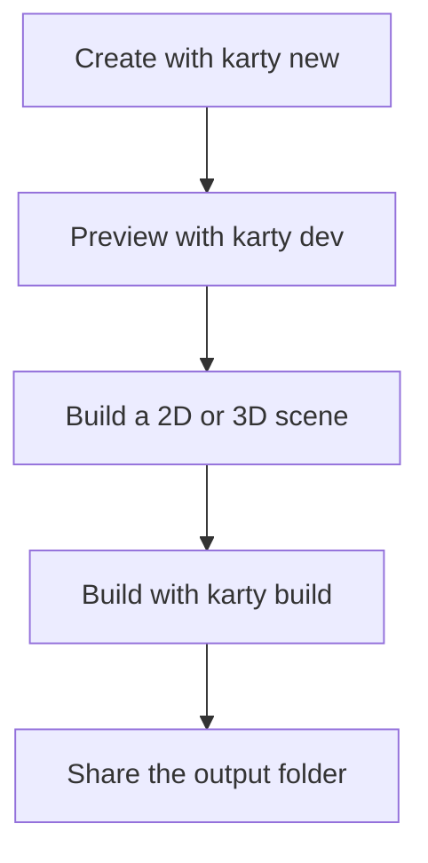
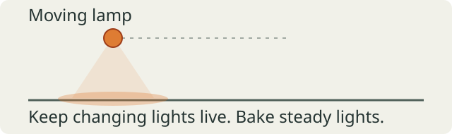
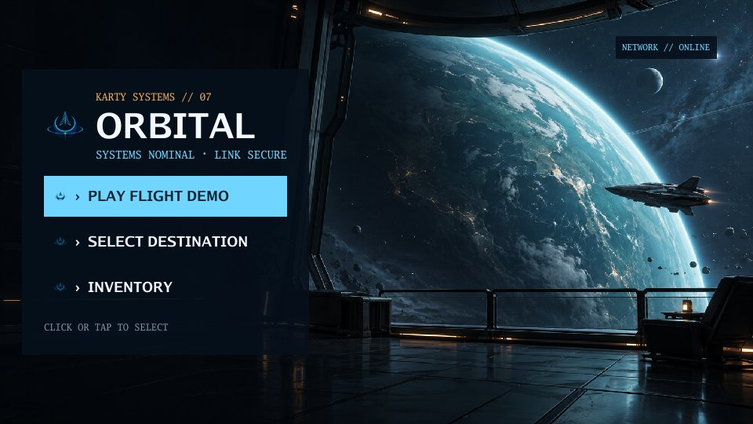
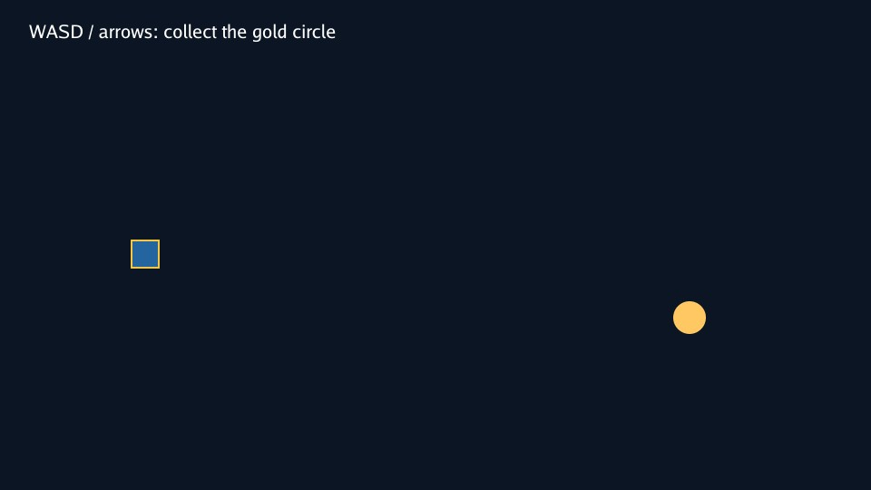

# Make a game with Karty

Create a project, choose a 2D or 3D scene, and add an interaction you can play.

## Why Karty?

I started Karty to make the engine and framework I wanted to use myself.

Unity and Unreal feel too big, too slow, and too general-purpose for my games.
I miss the directness of Doom and Half-Life level editors. Making a room and
trying it felt simple.

I want to model and texture my game directly in the editor, make a change,
and see it immediately. Move a wall, swap a material, or place an object
without waiting for a full rebuild.

I want to supply one albedo image and let the tools generate normal and
smoothness maps that make the material look good. I don't want to spend hours
tuning every map by hand.

I don't want to spend my time tuning LODs, mipmaps, or lightmaps. I want to
place things where I want them and let the editor handle those details.

I don't want to reinvent particle systems or UI for every game. I want a
library of effects and components I can reuse whenever I need them.

I'm building Karty toward that workflow. The goal is to make games and
prototypes that look good, with as little setup and extra work as possible.

## Start with a playable game

Install the [Karty CLI](https://github.com/karty-game/karty/releases/latest), then run:

```sh
karty new my-game
cd my-game
karty dev
```

Open the address printed by the preview. Change a color or a movement speed in
`src/main.go`, save, and try it again. The first setup downloads tools; later
builds reuse them.



Keep `karty.toml`, your Go source, and source assets in Git. The CLI recreates
`.karty/` and `dist/`. Your project pins an exact SDK; use its `.karty/docs/`
reference for API names and supported features.

Make one small game rule work before adding more art: collect an item, reach a
goal, or restart after losing. For a 3D game, use the camera and loading code
from [Roman court & galleries](../world-camera/) as your starting point.

## Build one room

A level has a manifest, world geometry, and its own textures. Create
`levels/room/`, add a tileable `surface.png`, and save this as `level.toml`:

```toml
[level]
name = "levels.room"
kind = "world"

[world]
source = "world.yaml"

[[textures]]
name = "surface"
source = "surface.png"
profile = "environment"
```

Save this as `world.yaml`. X/Y describe the floor plan; Z is height. These
coordinates make an eight-metre square room with a three-metre ceiling.

```yaml
version: 6
rooms:
  - id: room
    floor: {c: 0}
    ceiling: {c: 3}
    floor_material: surface
    ceiling_material: surface
    boundary:
      - {id: south, start: {x: 0, y: 0}, end: {x: 8, y: 0}, material: surface}
      - {id: east, start: {x: 8, y: 0}, end: {x: 8, y: 8}, material: surface}
      - {id: north, start: {x: 8, y: 8}, end: {x: 0, y: 8}, material: surface}
      - {id: west, start: {x: 0, y: 8}, end: {x: 0, y: 0}, material: surface}
```

Walk the boundary counterclockwise and keep each edge joined to the next.
Run `karty schema` for editor suggestions, or `karty schema --check` to check
the world before processing assets.

Replace `src/main.go` with this room viewer. Change the import if your project
has a different name. The camera starts at `(2, 2, 1.7)`; the text shows loading
errors above the scene.

```go
package main

import "example.com/my-game/.karty/engine"

type Game struct {
    engine.Game
    request engine.LevelRequestID
    camera *engine.EntityCamera3D
    label *engine.EntityText2D
}

//go:wasmexport karty_register
func main() {
    game := &Game{}
    engine.Run(engine.Hooks{
        OnStart: func() {
            game.label = game.NewText2D("Loading room...", engine.NewVec2D(24, 24))
            game.request = game.RequestLevel("levels.room")
        },
        OnLevelReady: func(event engine.LevelReady) {
            if event.RequestID != game.request { return }
            game.camera = game.NewCamera3D(event.Handle, engine.CameraSettings{
                Projection: engine.CameraProjectionPerspective, Output: engine.CameraOutputFull,
                Position: engine.NewVec3D(2, 2, 1.7), FOVY: 1.05,
                Near: 0.05, Far: 100, OrthoHeight: 10,
                ViewportWidth: 960, ViewportHeight: 540,
            })
            game.camera.SetLayer(-1)
            game.label.SetText("")
        },
        OnLevelFailed: func(event engine.LevelFailed) {
            if event.RequestID == game.request { game.label.SetText(event.Diagnostic) }
        },
    })
}
```

Run `karty dev` to view the room. Match the viewport to your `karty.toml`
resolution if you change it. This camera stays still. Add [first-person
controls](fps.html) to walk around, or an [isometric camera](isometric.html) to
view the room from above.


Add a second room only after you can explore the first. A connection names an
edge in each room and opens a portal between them; see the court sample for
complete connections.

## Give surfaces a material

Use a small tileable image first. The texture's `name` is the material name
used by floors, ceilings, and boundary edges. Texture paths are relative to
`level.toml`.

Add this at the top level of `world.yaml` to repeat the image every two metres:

```yaml
uv:
  mode: triplanar
  anchor: world
  scale: {x: 2, y: 2}
```

Scale is metres per repeat: a larger value makes the pattern larger. Set a
room's `wall_uv`, `floor_uv`, or `ceiling_uv` to change only those surfaces.
World anchoring keeps repeats aligned when you place prefabs.

Materialize generates height, normal, and ambient occlusion maps for world
surfaces. SDKs with material reflectance also generate metallic and smoothness
maps. Add a preset immediately after the texture entry in `level.toml`:

```toml
[textures.materialize]
preset = "concrete"
```

Run `karty build --target web` to generate and cache the maps. The CLI makes
world textures seamless automatically. These controls apply to world surfaces;
sprite textures keep their original image processing.

### Choose a preset

Use these exact lowercase names:

- `default` balances surface detail. This is the default when no preset is set.
- `auto` chooses a preset by analysing the source image.
- `skin` produces smooth, non-metallic skin.
- `floor` emphasises height and ambient occlusion for ground surfaces.
- `metal` strengthens metallic detail and sharp edges.
- `fabric` produces soft, matte cloth.
- `wood` preserves moderate grain detail.
- `stone` produces rough rock with deep ambient occlusion.
- `concrete` produces rough concrete.
- `leather` produces pebbled leather with some smoothness.
- `marble` produces polished, veined stone.
- `sand` produces fine, rough grain.
- `foliage` suits leaves and grass with little metallic detail.
- `plaster` keeps surfaces flat with soft normals.
- `asphalt` produces rough surfaces with dense edge detail.
- `brick` emphasises sharp edges and rough surfaces.
- `ice` produces smooth surfaces with subtle detail.
- `snow` produces soft, diffuse surfaces.
- `lava` produces partly metallic, molten surface detail.
- `water` produces smooth water surface detail.

Presets change generated maps. They do not add liquid motion or light emission.
Start with their defaults. Use `normal_strength`, `height_contrast`,
`metallic_scale`, or `ao_depth_scale` only when the result needs adjustment.
The separate `textures.material_strengths` settings control how strongly the
game displays those maps. See the [material reference](https://github.com/karty-game/karty/blob/main/docs/assets.md)
for overrides and limits.

Check the result at player height. A material that looks good close up may
repeat too obviously across a large wall. [The Hangar](../hangar/) shows wall
bands, secondary weathering, and small sprite decals.

## Reuse a static object

A prefab groups geometry so you can place it more than once. Add this at the
top level of the room's world file:

```yaml
prefabs:
  - id: crate
    solids:
      - id: body
        footprint: [{x: 0, y: 0}, {x: 1, y: 0}, {x: 1, y: 1}, {x: 0, y: 1}]
        bottom: {c: 0}
        top: {c: 1}
        side_material: surface
        top_material: surface
        bottom_material: surface
        collision: true
instances:
  - id: crate-a
    prefab: crate
    transform:
      translation: {x: 4, y: 4, z: 0}
      yaw_degrees: 20
```

Solid footprints must be convex and counterclockwise. Split an L-shaped object
into several solids. Use room geometry for passages and platforms: a solid's
collision blocks movement, but does not make its top walkable.

An instance can translate, rotate, uniformly scale, or substitute materials.
Its expanded object keeps a stable name such as `crate-a/body`. Prefabs can
also contain rooms and sprites. Light positions remain global; placing a
prefab does not place or move lights for it.

Keep static objects static. Visual animation does not move collision or
gameplay query positions. For a door or moving platform, check the pinned SDK's
supported behavior before designing the interaction.


## Light the scene, then bake

Add a warm lamp at the top level of `world.yaml`:

```yaml
lighting:
  version: 1
  ambient: {x: 0.05, y: 0.05, z: 0.06}
  lights:
    - id: room-lamp
      position: {x: 4, y: 4, z: 2.5}
      color: {x: 1, y: 0.75, z: 0.45}
      radius: 6
```

Start with one lamp and low ambient light. Keep its radius near the space it
needs to illuminate. Add lights where they help players read an entrance,
obstacle, or goal.

Bake steady lights so they do not need live lighting each frame. Add this
to `level.toml`:

```toml
[lightmap]
enabled = true
offline = true
density = 4
page_size = 512
bake_samples = 16
bake_bounces = 1
```

For this room, run `karty bake`, then `karty dev`. Rebake after changing geometry,
textures, UVs, or baked lights. Restart an existing preview after baking.
Begin at low density; increase it only when shadow detail needs it.

Eligible steady sources bake automatically. Moving lights and lights linked to
a changing emission pulse stay live. Keep the live set small; the current
live authored point-light table holds at most 50. A glowing material does not light
its surroundings by itself; add a light for that effect.



Larger levels can opt into chunks. For chunked levels, `karty build` produces
missing bakes; `karty dev` previews with a matching bake or live lighting.
Learn that workflow in [Roman court & galleries](../world-camera/) after the
single-room version works.

## Turn movement into an interaction

Use typed hooks for startup, frames, input, and level results. Match each level
result to the request that created it. Handle `OnLevelFailed` with a message
the player can read.

These snippets extend a controller with a loaded `camera`. Add these fields
to your `Game`:

```go
status string
nearGoal, won bool
```

After creating the camera, check its starting position and subscribe to later
accepted poses. Registration alone does not call the callback.

```go
updateGoal := func(position engine.Vec3D) {
    dx, dy := position.X-6, position.Y-6
    game.nearGoal = dx*dx+dy*dy < 1
}
updateGoal(game.camera.Settings.Position)
_, err := game.WatchTransform(game.camera, func(pose engine.Transform3D) {
    // The host has applied collision and portal movement.
    updateGoal(pose.Position)
})
if err != nil {
    game.status = err.Error()
}
```

Propose movement from `camera.Settings`, which the hook keeps synchronized
with the accepted pose. Do not accumulate a separate guessed player position.

The position check defines a one-metre trigger around `(6, 6)`. Call this method
from your existing `OnKeyDown` handler to finish when the player presses E there.
Keep the movement handler in that hook too.

```go
func (game *Game) onKeyDown(key engine.Key) {
    if key == engine.KeyE && game.nearGoal && !game.won {
        game.won = true
        game.status = "You made it!"
    }
}
```

Draw `status` in your HUD; invalidate it when the value changes if using
KartUI. Reset `won` when starting again. Reset held controls in `OnInputReset`
so losing focus does not leave the player moving.

Tags identify actors; they do not automatically create proximity events. Query
actors after the level is ready, and keep trigger checks in your game. For
longer scripted interactions, the court sample uses typed actions and
`StartAuthoredSequence`; start with a direct Go handler first.

## Add sound and video

Put a short WAV effect in `assets/sounds/`. The CLI converts it to QOA and
generates a typed sound ID. Declare music and video in `karty.toml`:

```toml
[[assets.sound]]
name = "ui.click"
source = "assets/sounds/click.wav"

[[assets.music]]
name = "theme"
source = "assets/music/theme.wav"
profile = "music"

[[assets.video]]
name = "intro"
source = "assets/videos/intro.mpg"
```

Add the generated assets import, then call these methods from a player button
or input handler:

```go
func (game *Game) startMedia() {
    game.PlaySound(assets.SoundUiClick)
    game.PlayMusic(assets.MusicTheme, engine.StreamOptions{Loop: true, CrossfadeMS: 500})
    game.PlayVideo(assets.VideoIntro, 300, 130, 360, 180)
}

func (game *Game) stopMedia() {
    game.StopMusic(500)
    game.StopVideo()
}
```

For `my-game`, the assets import is `example.com/my-game/.karty/assets`.
Use the generated names in `.karty/assets/`. Play the click once per action,
and start music once when entering a screen or level.

Browser audio needs player input before it can play. Video sources must already
be MPEG-1 in an `.mpg` container, optionally with MP2 audio. The CLI does not
convert MP4. One video plays at a time; pause, seeking, and video looping are
not supported. The four position values set its top-left and display size.

Keep the built `content/` folder when sharing music or video. Use
[Media lab](../media-lab/) to check playback and overlapping effects.


## Make menus and a pause screen

Use KartUI for menus, HUDs, and overlays in 2D, first-person, or isometric games.

Keep screen state in Go and screen structure in `.kui` files. The CLI discovers
components under `ui/`, shared layouts under `ui/layouts/`, and a theme at
`ui/theme.toml`.

Save this shared frame as `ui/layouts/screen-frame.kui`:

```kui
<template>
  <panel modal="true" class="screen">
    <panel class="card"><slot/></panel>
  </panel>
</template>

<style>
.screen
  height: 100%
  flex-grow: 1
  align: center
  justify: center
  background: theme.colors.surface
.card
  padding: 24
  gap: 12
  max-width: 420
  flex-grow: 1
</style>
```

Save the menu as `ui/views/menu.kui`. The filename gives it the generated name
`ui.Menu`:

```kui
<template>
  <ScreenFrame>
    <label>My game</label>
    <button onClick={ onPlay }>Play</button>
  </ScreenFrame>
</template>

<script setup lang="go">
func setup(onPlay func()) {}
</script>
```

Save a second screen as `ui/views/pause.kui`:

```kui
<template>
  <ScreenFrame>
    <label>Paused</label>
    <button onClick={ onResume }>Resume</button>
  </ScreenFrame>
</template>

<script setup lang="go">
func setup(onResume func()) {}
</script>
```

Add a `screen *engine.UI` field and the import
`example.com/my-game/.karty/ui`. Open one screen at a time:

```go
func (game *Game) showMenu() {
    if game.screen != nil { game.screen.Close() }
    game.screen = ui.Menu(func() {
        game.screen.Close()
        game.screen = nil
        // Start or resume your game here.
    })
}
```

Call `game.showMenu()` from `OnStart`. Open `ui.Pause` the same way from your
existing input hook, for example when `OnKeyDown` receives `engine.KeyEscape`.
Set a `playing` flag to false when pausing and
skip game movement in `OnUpdate` until Resume sets it true. A modal panel
captures input; your Go code decides whether the game simulation pauses.

Layouts share structure and styles. Component callbacks change game state.
Call `Invalidate()` after changing data used by dynamic UI bindings. Test your
layout at a narrow viewport before adding more screens. [Orbital flight
deck](../ui-demo/) shows menus, loading, inventory, gameplay, and pause screens.



## Build and share

Use `--target web` for browsers and `--target native` for desktop games.
SDK 0.0.11 provides these runtimes:

| Game platform       | `--platform`    | Build on this machine             |
| ------------------- | --------------- | --------------------------------- |
| Browser             | Omit this flag  | Any supported development machine |
| Linux x64           | `linux-amd64`   | Yes                               |
| Linux ARM64         | `linux-arm64`   | Yes                               |
| macOS Apple silicon | `darwin-arm64`  | Yes                               |
| Windows x64         | `windows-amd64` | Yes                               |
| Windows ARM64       | `windows-arm64` | No native TinyGo toolchain        |

Every supported development machine can package any listed game platform.
The CLI compiles one WASM cartridge and downloads the destination's
checksum-verified host. Players need neither the CLI nor TinyGo.

### Publish a browser game

From your project's folder:

```sh
karty build --target web
karty serve dist/web --addr 127.0.0.1:8080
```

Open `http://127.0.0.1:8080/` and test the built game. Upload the whole
`dist/web/` directory to a static host, including `content/` when present.
Use HTTP hosting; opening `index.html` directly is not the preview workflow.

### Build and run a native game

Build for your current machine, then launch it on Linux or macOS:

```sh
karty build --target native
cd dist/native
./karty-host --cartridge game.kart
```

On Windows, run `.\karty-host.exe --cartridge game.kart` in PowerShell from
`dist/native/`. The build summary prints the command for your machine.

To package another platform, run these from the project root:

```sh
karty build --target native --platform windows-arm64
karty build --target native --platform linux-arm64
karty build --target native --platform darwin-arm64
```

Explicit platforms use separate folders, such as
`dist/native/windows-arm64/`. On the destination Windows machine, open that
folder and run `.\karty-host.exe --cartridge game.kart`.

Share the whole selected folder, including its `content/` files.
Include [RUNTIME_LICENSE.md](https://github.com/karty-game/karty-sdk/releases/download/sdk-v0.0.11/RUNTIME_LICENSE.md)
and [SDK_LICENSE.md](https://github.com/karty-game/karty-sdk/releases/download/sdk-v0.0.11/SDK_LICENSE.md)
from your SDK release, plus notices required by your own assets and dependencies.
Browser and desktop use the same source. Test each platform you ship.

### Build in CI

Commit `karty.toml`, `go.mod`, source code, and source assets. Include `go.sum`
when your dependencies create it.
The runner recreates `.karty/` and `dist/`; do not commit those folders.

Save this as `.github/workflows/game.yml` in a game project pinned to SDK
0.0.11. It builds a browser game and a Windows ARM64 distribution on Linux,
then uploads each folder for review. It pins a public CLI source revision
because the current [CLI binary release, v0.0.1](https://github.com/karty-game/karty/releases/tag/v0.0.1),
predates `--platform`.
No private engine checkout or credentials are needed.

```yaml
name: Build game
on: [push, pull_request]
permissions:
  contents: read
jobs:
  build:
    runs-on: ubuntu-24.04
    env:
      GOEXPERIMENT: simd
      GOWORK: "off"
    steps:
      - uses: actions/checkout@v7.0.1
        with:
          persist-credentials: false
      - uses: actions/setup-go@v7.0.0
        with:
          go-version: "1.27.1"
          cache: false
      - name: Install the pinned public CLI
        run: |
          go install github.com/karty-game/karty/cmd/karty@3bb2953071e02795e59cf96b8acd362cd21edbdf
          echo "$(go env GOPATH)/bin" >> "$GITHUB_PATH"
      - name: Install SDK and software material generation
        run: |
          karty sdk install 0.0.11
          sudo apt-get update
          sudo apt-get install -y --no-install-recommends libegl1 libgl1-mesa-dri
      - name: Build distributions
        run: |
          karty build --target web
          karty build --target native --platform windows-arm64
          for notice in RUNTIME_LICENSE.md SDK_LICENSE.md; do
            curl -fsSL "https://github.com/karty-game/karty-sdk/releases/download/sdk-v0.0.11/$notice" -o "$RUNNER_TEMP/$notice"
            cp "$RUNNER_TEMP/$notice" dist/web/
            cp "$RUNNER_TEMP/$notice" dist/native/windows-arm64/
          done
      - uses: actions/upload-artifact@v7.0.0
        with:
          name: game-web
          path: dist/web/
          if-no-files-found: error
      - uses: actions/upload-artifact@v7.0.0
        with:
          name: game-windows-arm64
          path: dist/native/windows-arm64/
          if-no-files-found: error
```

Change the native `--platform`, artifact name, and artifact path together.
For Linux or macOS artifacts, upload a tar archive of the folder to
[preserve the host's executable permission](https://github.com/actions/upload-artifact/tree/v7.0.0#permission-loss).
For offline lighting, add `karty bake` before the builds. Material generation
uses Mesa software OpenGL when the runner has no GPU; the libraries above
provide its EGL backend. Packaging a game in CI does not test its graphics,
input, or sound on the destination platform.

Choose a sample to extend:

- [Roman court & galleries](../world-camera/): cameras, portals, typed hooks, and chunks.
- [The Hangar](../hangar/): static objects, detailed materials, baked lights, and a torch.
- [Orbital flight deck](../ui-demo/): menus and reusable KartUI components.
- [Media lab](../media-lab/): sound, music, and video.

## Draw a 2D game

Use sprites for image artwork, vectors for shapes, and text for instructions
and scores. This example draws all three and lets you collect a circle with
keyboard movement.

### Add a sprite

Create a project from the [guide home](index.html). Download
[player.png](assets/player.png) and save it as `assets/textures/player.png`.
The CLI imports that image and generates `assets.TexturePlayer` on the next
build. Use the generated ID when creating the sprite.

### Draw and play

Keep the project resolution at 960 by 540. Replace `src/main.go` with this
scene. Change the imports if your project has a different name.

```go
package main

import (
    "example.com/my-game/.karty/assets"
    "example.com/my-game/.karty/engine"
)

const speed = float32(3)

type Game struct {
    engine.Game
    player *engine.EntitySprite2D
    goal *engine.EntityVector2D
    label *engine.EntityText2D
    keys [engine.KeyMeta + 1]bool
    won bool
}

//go:wasmexport karty_register
func main() {
    game := &Game{}
    engine.Run(engine.Hooks{
        OnStart: game.start,
        OnUpdate: game.update,
        OnKeyDown: func(key engine.Key) { game.key(key, true) },
        OnKeyUp: func(key engine.Key) { game.key(key, false) },
        OnInputReset: func() { clear(game.keys[:]) },
    })
}

func (game *Game) start() {
    // Draw the background behind the sprite, goal, and text.
    background := game.NewVector2D(engine.Rectangle(960, 540), engine.NewVec2D(0, 0))
    background.SetFill(engine.RGBA(12, 21, 35, 255))
    background.SetLayer(-1)
    game.player = game.NewSprite2D(assets.TexturePlayer, engine.NewVec2D(160, 280))
    game.goal = game.NewVector2D(engine.Circle(18), engine.NewVec2D(760, 350))
    game.goal.SetFill(engine.RGBA(255, 200, 99, 255))
    game.label = game.NewText2D("WASD / arrows: collect the gold circle", engine.NewVec2D(32, 24))
    game.label.SetSize(20)
    game.label.SetLayer(1)
}

func (game *Game) key(key engine.Key, down bool) {
    if key == engine.KeyR && down {
        clear(game.keys[:])
        game.won = false
        game.player.Translate(160-game.player.Position.X, 280-game.player.Position.Y)
        game.goal.SetAlpha(1)
        game.label.SetText("WASD / arrows: collect the gold circle")
    }
    if int(key) < len(game.keys) { game.keys[key] = down }
}

func (game *Game) update(engine.Frame) {
    if game.won { return }
    var dx, dy float32
    if game.keys[engine.KeyA] || game.keys[engine.KeyLeft] { dx -= speed }
    if game.keys[engine.KeyD] || game.keys[engine.KeyRight] { dx += speed }
    if game.keys[engine.KeyW] || game.keys[engine.KeyArrowUp] { dy -= speed }
    if game.keys[engine.KeyS] || game.keys[engine.KeyArrowDown] { dy += speed }
    // Keep diagonal movement as fast as movement along one axis.
    if dx != 0 && dy != 0 { dx *= 0.7071068; dy *= 0.7071068 }
    if dx != 0 || dy != 0 {
        x := min(max(game.player.Position.X+dx, 16), 944)
        y := min(max(game.player.Position.Y+dy, 80), 524)
        game.player.Translate(x-game.player.Position.X, y-game.player.Position.Y)
    }
    // Our game collects the goal within 32 pixels of its centre.
    dx = game.player.Position.X - game.goal.Position.X
    dy = game.player.Position.Y - game.goal.Position.Y
    if dx*dx + dy*dy < 32*32 {
        game.won = true
        game.goal.SetAlpha(0)
        game.label.SetText("Collected! Press R to restart")
    }
}
```

Run `karty dev`. Move with WASD or the arrow keys, reach the circle, then press
R to try again. `OnInputReset` clears held keys when the game loses focus.
Karty updates at 60 Hz, so a speed of three moves 180 pixels per second.

### Change the drawing

Positions use canvas pixels. The upper left is `(0, 0)`; X grows right and Y
grows down. Sprite and circle positions mark their centres. Rectangle and text
positions mark their upper-left corners.

`NewSprite2D` draws the imported image. `NewVector2D` draws the rectangle and
circle without image files. `NewText2D` draws the instruction, and `SetText`
changes it when the goal is collected. Higher layers draw above lower ones.

Try another PNG, change the circle's radius or color, or move the goal. Use
setters such as `Translate`, `SetFill`, and `SetText` to update existing
entities instead of creating them again each frame.



### Add feedback and share

[Sound and video](media.html) add effects or music. [Build and share](share.html)
packages your game for the browser or desktop.

[KartUI](ui.html) is optional when you need menus or reusable screen layouts.
Its components work with both 2D and 3D games.

## Make a first-person game

Choose this view for walking through rooms and interacting with objects at eye
height. Start with [one room](levels.html), then add these controls to its viewer.
Keep the loading and failure hooks from that page.


### Set the camera height

Use these settings in `game.NewCamera3D(event.Handle, settings)`. X/Y are floor
coordinates; Z is height. A yaw of zero faces positive Y. Angles use radians.

```go
settings := engine.CameraSettings{
    Projection: engine.CameraProjectionPerspective,
    Output: engine.CameraOutputFull,
    Position: engine.NewVec3D(2, 2, 1.7),
    Yaw: 0, Pitch: 0, FOVY: 1.05,
    Near: 0.05, Far: 100, OrthoHeight: 10,
    ViewportWidth: 960, ViewportHeight: 540,
}
```

Keep `game.camera.SetLayer(-1)` so the loading label and later HUD appear above
the world. Match the viewport to the resolution in `karty.toml`.

### Add walking controls

W/S move forward and back. A/D strafe. Q/E turn. Add `math` to the imports, and
add these fields inside `Game`:

```go
forward, backward, left, right bool
turnLeft, turnRight bool
fpsReady bool
```

After creating the camera and setting its layer, register accepted transforms.
Put this before `game.label.SetText("")` in `OnLevelReady`:

```go
if _, err := game.WatchTransform(game.camera, nil); err != nil {
    game.label.SetText(err.Error())
    return
}
game.fpsReady = true
```

`WatchTransform` updates `camera.Settings` with the pose the host accepted. The
next frame starts there, including any collision stop or portal change. The
`nil` callback is enough for movement. Add an interaction callback to this same
registration when you need one.

Add these entries to the existing `engine.Hooks`:

```go
OnUpdate: func(engine.Frame) { game.updateFPS() },
OnKeyDown: func(key engine.Key) { game.keyFPS(key, true) },
OnKeyUp: func(key engine.Key) { game.keyFPS(key, false) },
OnInputReset: game.resetFPS,
```

Add these methods after `main`. Karty updates at 60 Hz, so a step of `0.04`
moves 2.4 metres per second. Normalizing the input keeps diagonal movement at
the same speed.

```go
func (game *Game) keyFPS(key engine.Key, down bool) {
    switch key {
    case engine.KeyW: game.forward = down
    case engine.KeyS: game.backward = down
    case engine.KeyA: game.left = down
    case engine.KeyD: game.right = down
    case engine.KeyQ: game.turnLeft = down
    case engine.KeyE: game.turnRight = down
    }
}

func (game *Game) resetFPS() {
    game.forward, game.backward, game.left, game.right = false, false, false, false
    game.turnLeft, game.turnRight = false, false
}

func fpsAxis(positive, negative bool) float32 {
    var value float32
    if positive { value++ }
    if negative { value-- }
    return value
}

func (game *Game) updateFPS() {
    if game.camera == nil || !game.fpsReady { return }
    forward := fpsAxis(game.forward, game.backward)
    strafe := fpsAxis(game.right, game.left)
    turn := fpsAxis(game.turnRight, game.turnLeft)
    if forward == 0 && strafe == 0 && turn == 0 { return }

    if length := math.Hypot(float64(forward), float64(strafe)); length > 1 {
        forward /= float32(length)
        strafe /= float32(length)
    }
    settings := game.camera.Settings
    settings.Yaw += turn * 0.025
    sine := float32(math.Sin(float64(settings.Yaw)))
    cosine := float32(math.Cos(float64(settings.Yaw)))
    settings.Position.X += (forward*sine + strafe*cosine) * 0.04
    settings.Position.Y += (forward*cosine - strafe*sine) * 0.04
    game.camera.SetSettings(settings)
}
```

Run `karty dev`, click the game, and walk toward a wall. Movement stops while
you can still turn. Switch away from the preview and back; `OnInputReset` clears
held keys so walking does not continue after focus changes.

The camera is a point. This controller does not change Z directly or add
gravity, jumping, or automatic stair climbing. Start with a flat room before
adapting the Hangar controller for stairs or touch input.

### Give the room a purpose

Add [textures](textures.html) and [prefabs](prefabs.html) before expanding the
map. Use [lighting](lighting.html) to make the route visible. Then add a nearby
object and an [interaction](interactions.html).

The interaction example uses E. Move turning to another key or use F for the
interaction, and call both handlers from your existing input hook. Use
[KartUI](ui.html) for prompts, [media](media.html) for feedback, and
[share a build](share.html) once the first room is playable.

## Make an isometric game

Choose this view when players need to see several rooms or plan around objects.
Start with [one room](levels.html), then replace its fixed viewpoint with an
orbiting camera. Keep the loading and failure hooks from that page.


Try the camera switch in [Roman court & galleries](../world-camera/) to compare
its walking and overhead views.

### Frame the room

Use these settings in `game.NewCamera3D(event.Handle, settings)`. It looks down
toward the centre of the eight-metre room. The diagonal yaw and downward pitch
give the isometric angle. Angles use radians.

```go
settings := engine.CameraSettings{
    Projection: engine.CameraProjectionIsometric,
    Output: engine.CameraOutputFull,
    Position: engine.NewVec3D(-7.313708, -7.313708, 11.313708),
    Yaw: 0.7853982, Pitch: -0.6154797,
    FOVY: 1.05, OrthoHeight: 12,
    Near: 0.05, Far: 100,
    ViewportWidth: 960, ViewportHeight: 540,
}
```

`OrthoHeight` is the visible height in world units. Increase it to show more of
the map. Parallel projection keeps distant objects the same size. This camera
can sit outside the world. Downward-facing ceilings disappear when viewed
from above.

Keep `game.camera.SetLayer(-1)` and match the viewport to `karty.toml`.

### Orbit without moving a player

Q/E rotate the view around `(4, 4)`. The camera keeps its distance, height, and
pitch. These controls move the view only; they do not move a player or actor.
Add `math` to the imports and these fields inside `Game`:

```go
orbitLeft, orbitRight bool
isoReady bool
```

After camera creation and the layer setting, put this before clearing the
loading label:

```go
if _, err := game.WatchTransform(game.camera, nil); err != nil {
    game.label.SetText(err.Error())
    return
}
game.isoReady = true
```

`WatchTransform` keeps `camera.Settings` synchronized with the accepted pose.
Start each proposal from those settings. Add these entries to the existing
`engine.Hooks`:

```go
OnUpdate: func(engine.Frame) { game.updateOrbit() },
OnKeyDown: func(key engine.Key) { game.keyOrbit(key, true) },
OnKeyUp: func(key engine.Key) { game.keyOrbit(key, false) },
OnInputReset: game.resetOrbit,
```

Add these methods after `main`. The orbit is centred on the room's floor, with
a radius of 16 metres. Change the centre when your level grows.

```go
func (game *Game) keyOrbit(key engine.Key, down bool) {
    switch key {
    case engine.KeyQ: game.orbitLeft = down
    case engine.KeyE: game.orbitRight = down
    }
}

func (game *Game) resetOrbit() {
    game.orbitLeft, game.orbitRight = false, false
}

func (game *Game) updateOrbit() {
    if game.camera == nil || !game.isoReady { return }
    var direction float32
    if game.orbitLeft { direction-- }
    if game.orbitRight { direction++ }
    if direction == 0 { return }

    settings := game.camera.Settings
    settings.Yaw += direction * 0.015
    // Wrap the angle so a long orbit stays precise.
    settings.Yaw = float32(math.Mod(float64(settings.Yaw)+2*math.Pi, 2*math.Pi))
    settings.Position.X = 4 - float32(math.Sin(float64(settings.Yaw))) * 16
    settings.Position.Y = 4 - float32(math.Cos(float64(settings.Yaw))) * 16
    game.camera.SetSettings(settings)
}
```

Run `karty dev`, click the game, and hold Q or E. The view should turn around
the room without changing its scale. Switch away and back to check that
`OnInputReset` stops the orbit.

### Build around the view

Use [textures](textures.html) that read at this distance and
[prefabs](prefabs.html) for objects with distinct shapes. Check
[lighting](lighting.html) while orbiting so important objects stay visible.

An orbiting camera's position is outside the room. Base player proximity
checks on a player actor or separate walking controller. The
[interaction guide](interactions.html) explains accepted poses and explicit
input hooks; its camera trigger applies to a walking camera.

Add [KartUI](ui.html) for selection and status, [media](media.html) for feedback,
then [share a build](share.html). The Roman court sample shows a separate
walking controller and an isometric camera over the same world.

