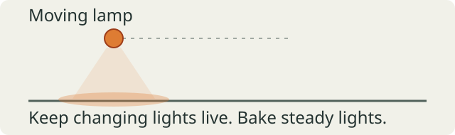

# Light the scene, then bake

Add a warm lamp at the top level of `world.yaml`:

```yaml
lighting:
  version: 1
  ambient: {x: 0.05, y: 0.05, z: 0.06}
  lights:
    - id: room-lamp
      position: {x: 4, y: 4, z: 2.5}
      color: {x: 1, y: 0.75, z: 0.45}
      radius: 6
```

Start with one lamp and low ambient light. Keep its radius near the space it
needs to illuminate. Add lights where they help players read an entrance,
obstacle, or goal.

Bake steady lights so they do not need live lighting each frame. Add this
to `level.toml`:

```toml
[lightmap]
enabled = true
offline = true
density = 4
page_size = 512
bake_samples = 16
bake_bounces = 1
```

For this room, run `karty build`, then `karty dev`. Rebake after changing geometry,
textures, UVs, or baked lights. Restart an existing preview after baking.
Begin at low density; increase it only when shadow detail needs it.

Eligible steady sources bake automatically. Moving lights and lights linked to
a changing emission pulse stay live. Keep the live set small; the current
live authored point-light table holds at most 50. A glowing material does not light
its surroundings by itself; add a light for that effect.



The current WebGPU profile prepares render cells automatically, including for a
single room. Each cell owns final GPU buffers and a local three-layer RNM KTX2;
material textures remain shared. `karty build` produces missing bakes, and
`karty dev` consumes matching completed bakes without tracing rays. Historical
profiles retain their declared bake and preview policy.
See [Hangar](../hangar/) for a larger level with baked lighting after the
single-room version works.

Render cells carry explicit sector and portal-space ownership. Portal traversal
controls streaming and lookahead; nearby coordinates across a transformed portal
are not treated as neighbors. `[chunks.gpu] cell_size` defaults to 16 metres.
Indoor chunks keep authored rooms whole; `cell_size` bounds their catalog
coordinates rather than cutting rooms. Build-only `room_groups` join stairs,
recesses and access rooms into one loading area. Hangar defines nine such areas
and uses a shared `liquid_edge_step = 0.5` for displaced liquid boundaries.
Groups must fit the authored page limit at unchanged density; capacity failures
are reported at build time.

Fixed lighting combines sun, sky and eligible steady lamps in one static bake.
For a chunked level, add `fixed = true` to the enabled offline `[lightmap]`
recipe above and set `enabled = true` in `[chunks]`.

Run `karty build` to produce each chunk's surface lighting, directional diffuse
probes and compiled static-light records together with its geometry. Only the
resident chunks keep their lighting data loaded. Moving objects use those
probes and a bounded selection of direct lights; changing emitters stay live.
Compiled terrain can join this mode: its geometry and baked directional
surface coefficients are partitioned into the same chunk resources.
Fixed bakes use the same processed albedo inputs as the world material atlas,
including texture profile filters and size limits. Only static surface albedos
count toward the bake's 16 Mi-pixel budget; sprite, foliage and normal-only
textures do not. Albedos from other chunks remain available during baking so
their surfaces can contribute bounced light.
Terrain crops must preserve the source's exact floating-point lattice. A
nonrepresentable crop fails with a diagnostic; use exactly representable
origins and cell sizes, or adjust chunk boundaries. Chunk boundaries must also
align with terrain cells so each chunk owns its cells completely. Chunk mesh budgets include
the retained terrain geometry and compiled meshes. The fixed scalar lighting
artifact has a 2 MiB limit, so dense terrain may need smaller chunks.
Static lighting has one authored configuration: changing the sun, sky or lamps
requires a rebake. Fixed lighting cannot be combined with imported prebakes,
explicit lamp selections, ray-distance cutoffs or environment variant recipes.

Large fixed-lit surfaces can opt into spatial render chunks:

```toml
[chunks.spatial]
tile_size = 32
# Optional larger loading units preserve the original geometry cells:
load_tile_size = 128
background_tile_size = 256
density = 2
background_density = 0.125
detail_bounds = [-96, -96, 96, 96]
solids = ["ocean", "seabed"]
# Optional coarse interior water geometry, with matching shared boundary samples:
liquid_edge_step = 2
background_liquid_subdivisions = 1
geometry_detail_bounds = [-96, -96, 96, 96]
```

Named solids and other faces wider than `tile_size` are clipped into render
children before lightmap packing. Primary surfaces retain `[lightmap].density`;
`[chunks.spatial].density` sets the detailed spatial receivers' density and
defaults to that same value. The authored detail rectangle should include the
playable area and the shadows and color variation that need detail. Beyond it,
larger tiles use `background_density`. This is an explicit distant quality
setting, not a test that the lighting is uniform. The entire source surface
remains covered, including beyond the initial camera's view. The background tile
size must be a power-of-two multiple of the detailed size.

Optional `load_tile_size` combines adjacent compatible children into larger
loading units. It must be a power-of-two multiple of `tile_size`, at most 4096
metres. Primary ownership, source bindings, texel density and geometric detail
remain unchanged: each unit retains the original clipped geometry cells inside
one shared mesh and atlas. Existing page, span and byte budgets can prevent a
merge. The setting applies to all selected surfaces, including landscape faces.

A child whose complete bake is exactly uniform within every chart can carry
nine directional RNM coefficients per chart and omit the
receiver image. This checks all baked samples, including shadows and bounced
color. Any variation keeps the detailed lightmap; the builder does not infer
uniform open water from a few corner samples.

Animated water requires a fixed `liquid_edge_step` along every tile boundary.
It must divide both tile sizes and align with the clipped outer bounds. This
keeps the same displaced edge geometry on both sides of a boundary. Optional
`background_liquid_subdivisions` limits interior geometry outside
`geometry_detail_bounds`, while preserving those shared edge samples and the
material's animated wave normals. These settings affect geometric detail;
lightmap density remains independent.

Each child carries its own geometry and baked lighting and streams through
frustum visibility and the normal residency budget. Large water surfaces retain
their original fluid identity, world texture coordinates and animation clock.
Primary chunks retain a separately compiled collision resource, so evicting a
render tile never changes physical ownership. Spatial builds allow a combined
decoded geometry budget up to 16 MiB per primary chunk, including its render,
collision and terrain resources; each encoded entry retains its 8 MiB limit.
Terrain replacements omit their
invisible floor charts before packing; terrain geometry and directional surface
coefficients stay with their primary chunks. Use smaller primary sector groups
when terrain needs finer streaming granularity.

Changing the partition, either density, geometry, terrain or materials requires
a new bake. Spatial previews require a matching completed `karty build`; a
missing bake does not substitute live lighting for the fixed spatial solution.

## Bake static reflections

For fixed chunk levels, run `karty render reflections <level>` after
baking lighting. A matching native host captures static cubemaps from automatic
indoor space centers.
The command uses the selected native host without running the game client.
WebGPU hosts also support [software capture](software-capture.html) for CI
and CLI tooling.

Captures are cached under `.karty/bakes/<level>/`. Builds automatically embed
captures matching the complete current level inputs. Re-run the command after
changing geometry, materials or baked lighting. Streaming chunks then load saved
images without capturing the room again. Reflective materials, glass and liquids
share stable receiver assignments and box projection. Moving objects remain
outside these static images.
