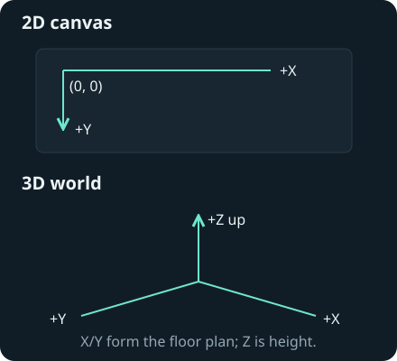

# Transforms



## Transform 2D

`Transform2D` places an entity in logical canvas pixels. X grows right and Y
grows down. Rotation uses radians.

| Method                           | Effect                          |
| -------------------------------- | ------------------------------- |
| `Set(position, scale, rotation)` | Replaces the complete transform |
| `Translate(dx, dy)`              | Adds a displacement             |
| `Scale(x, y)`                    | Sets the scale factors          |
| `Rotate(angle)`                  | Adds an angle                   |

```go
func place(sprite *engine.EntitySprite2D) {
    sprite.Set(engine.NewVec2(240, 180), engine.NewVec2(2, 2), 0)
    sprite.Translate(1, 0)
    sprite.Rotate(0.01)
}
```

Sprite and circle positions mark their centres. Text and rectangle positions
mark their upper-left corners. `SetLayer` controls drawing order; higher layers
draw later. Direct field assignments do not send changes to the host.

[Camera 2D](cameras.html#camera-2d) · [2D guide](../guide/2d.html)

## Transform 3D

`Transform3D` uses X/Y for the floor plan and Z for height. Samples use metres.
`Yaw`, `Pitch` and `Roll` use radians; camera yaw zero faces positive Y and
positive pitch looks down.

| API                             | Behavior                                               |
| ------------------------------- | ------------------------------------------------------ |
| `NewTransform3D(position)`      | Creates a pose with unit scale                         |
| `ref.SetPose(pose)`             | Proposes a new world pose                              |
| `WatchTransform(ref, callback)` | Delivers host-accepted poses after movement resolution |
| `subscription.Stop()`           | Stops transform notifications                          |

Accepted poses synchronize automatically. Read `sprite.Ref().Pose()` for the
next movement baseline; a watch adds an optional notification:

```go
func step(sprite *engine.EntityWorldSprite, dx float32) error {
    accepted, known := sprite.Ref().Pose()
    if !known { return nil }
    accepted.Position.X += dx
    return sprite.Ref().SetPose(accepted)
}
```

`EntityRef` is shared by rendering, physics, queries, lights, audio and authored
actions. Obtain it with `entity.Ref()` or a world discovery result. `Alive()`
checks lifetime. The SDK synchronizes accepted poses before callbacks, without
requiring a watch. Local proposals do not notify. Physical entities use
`Body.Teleport`; detach a body before returning to free pose control.

A zero-valued `Transform3D` has zero scale. Use the constructor for visible
objects. World authoring fields named `yaw_degrees` use degrees.

[Camera 3D](cameras.html#camera-3d) · [Hangar camera movement](https://github.com/karty-game/karty/blob/main/samples/hangar/src/fps_controller.go)
