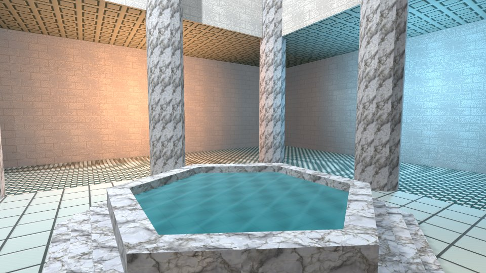

# Karty samples

Pick a sample to play, then open its source to see how it works.
[Browse all demos](https://karty-game.github.io/karty/main/) or
[make your first game](https://karty-game.github.io/karty/main/guide/).

## Orbital flight deck

Build a game interface with KartUI tabs, settings, tooltips and inventory.
Change the ship and thruster power while the flight runs.

[](https://karty-game.github.io/karty/main/ui-demo/)

[Play sample](https://karty-game.github.io/karty/main/ui-demo/) |
[Source on GitHub](https://github.com/karty-game/karty/tree/main/samples/ui-demo) |
[Controls](ui-demo/README.md)

## Roman court and galleries

Build textured 3D rooms with reusable geometry and lights. Switch between
first-person and isometric cameras, inspect actors and try touch controls.

[](https://karty-game.github.io/karty/main/world-camera/)

[Play sample](https://karty-game.github.io/karty/main/world-camera/) |
[Source on GitHub](https://github.com/karty-game/karty/tree/main/samples/world-camera) |
[Controls](world-camera/README.md)

## Hangar: industrial 3D level

Walk through connected rooms and stairs. Study layered materials, baked lighting,
a camera-mounted torch, animated machinery and particles.

[](https://karty-game.github.io/karty/main/hangar/)

[Play sample](https://karty-game.github.io/karty/main/hangar/) |
[Source on GitHub](https://github.com/karty-game/karty/tree/main/samples/hangar) |
[Controls and authoring notes](hangar/README.md)

## Media lab

Import images, sound, music and video. Play overlapping sound effects,
toggle looping music and replay a video in one scene.

[](https://karty-game.github.io/karty/main/media-lab/)

[Play sample](https://karty-game.github.io/karty/main/media-lab/) |
[Source on GitHub](https://github.com/karty-game/karty/tree/main/samples/media-lab) |
[Controls](media-lab/README.md)

The [environment lab](environment/README.md) is still in development and has no
published demo.

## Make it yours

From the repository root:

```sh
mise install
mise run build
./dist/karty sdk install "$(./dist/karty sdk current)"
cd samples/ui-demo
../../dist/karty dev
```

Open the address printed in your terminal. Edit and save to rebuild the preview.
Replace `ui-demo` with another sample's folder name.
The courtyard has separate [launch steps](world-camera/README.md#run-it).

Sample CI installs each project's pinned public SDK. It bakes each unchunked level
with offline lightmaps before building the web preview. Chunked levels bake their
children during the build. A failed bake stops packaging.
