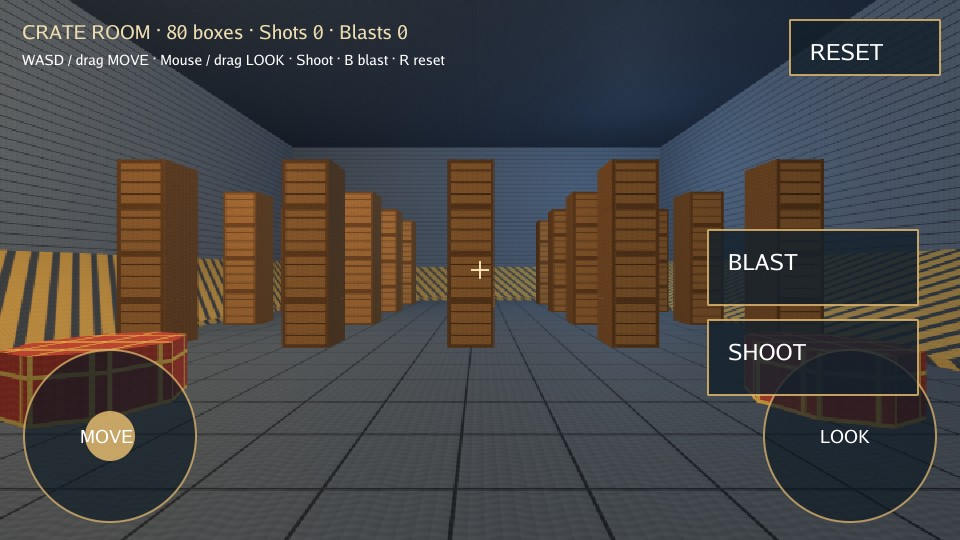

# Crate room

A physics and 3D audio playground full of stacked wooden crates. Shoot, push and
blast them around to see collisions, bouncing and tumbling, with desktop and
touch controls. Blasts pop into curled cartoon smoke clouds; wooden
impact sounds follow the crates in XYZ space as you walk and turn.



[Play](https://karty-game.github.io/karty/main/crate-room/) · [All samples](../README.md)

## Try it

Use **WASD** to move and **Shift** to run. Click to capture the mouse and look
around; **Escape** releases it. **Click / Space** shoots, **B / right-click**
blasts, and **R** resets the crates. On touch screens, use the movement, look
and weapon controls.

Try blasting a stack, then turn away while it falls: impact sounds pan with your
view and fade with distance, including height. Resting crates stay quiet, and
impact thresholds, cooldowns and voice limits keep cascades from becoming noisy.

## Built with

- [FPS Kit](https://karty-game.github.io/karty-packages/packages/fps-kit.html): crate models, room materials and bumpers.
- [3D Controllers](https://karty-game.github.io/karty-packages/packages/controllers-3d.html): first-person movement, mouse look and touch controls.
- Original [synthesized sounds](assets/sounds/README.md): cartoon weapons and wooden knocks.
- Original [smoke artwork](levels/room/effects/README.md): gray puffs with pale outlines and spiral curls.
- Original [crate oak](levels/room/wood/README.md): seamless plank joints, growth rings, knots and stronger generated material relief.

## Run locally

[Set up the CLI](../README.md#run-a-sample), then from the repository root:

```sh
cd samples/crate-room
../../dist/karty dev
```

Explore [the game](src/main.go), [crates](src/crates.go) and [weapons](src/gun.go).
The [particle emitter](src/particles.go) uses a fixed pool of camera-facing 3D
sprites; the pinned SDK's mounted GPU particles do not yet expose gameplay
triggers. [Audio](src/audio.go) infers contact from sudden speed loss because
the SDK has no contact events; this is an impact heuristic, including crate
collisions, rather than a material-specific contact callback.

After building, run `mise run check-crate-room-effects` from the CLI root to
exercise actual WASM particles, impact limits, listener rotation and stereo
WebAudio. Its report and blast/smoke captures are in
`dist/validation/crate-room-effects/`. `mise run check-crate-room-ui` checks
desktop and touch controls separately.
