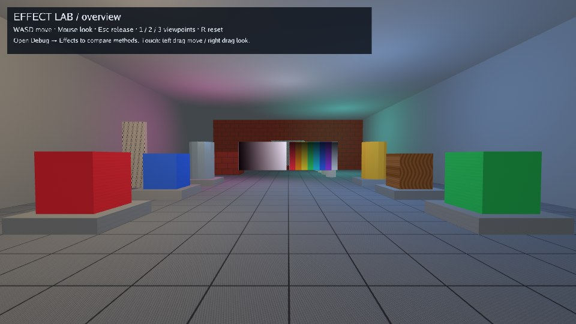

# Retro effect lab

A small first-person room for trying different visual styles. Compare bloom,
color grading, outlines, grain and retro display effects against the same
lights, materials and color charts.



[Play](https://karty-game.github.io/karty/main/effect-lab/) · [All samples](../README.md)

## Try it

Use **WASD** to walk; click to look with the mouse and **Escape** to release it.
Touch drags on the left and right move and look. Open **Debug → Effects** to
try presets and sliders. Use **Enable effects** for a before/after comparison
and **Clean** to reset. Keys **1–3** select viewpoints.

## Built with

- [3D Controllers](https://karty-game.github.io/karty-packages/packages/controllers-3d.html): camera movement, mouse look and touch controls.

## Run locally

[Set up the CLI](../README.md#run-a-sample), then from the repository root:

```sh
cd samples/effect-lab
../../dist/karty dev
```

Explore [the game](src/main.go), [camera](src/camera.go) and [room](levels/room/world.yaml).
