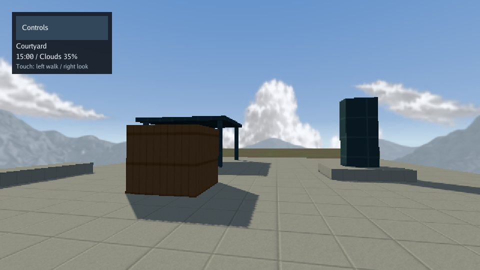

# Open Air

A first-person courtyard and meadow for exploring daylight, clouds, glass,
physics furniture and outdoor vegetation. Change the hour or cloud coverage
to compare lighting across the same scene.

[Play the demo](https://karty-game.github.io/karty/main/environment/) · [All samples](../README.md)



## Run it

Install the SDK selected in [karty.toml](karty.toml), then run from the CLI repository root:

```sh
mise run build
mise run check-environment-schema
mise run build-environment-web
mise run serve-environment
```

For local engine development, set `KARTY_HOST_WEB` or `KARTY_HOST_NATIVE` to the
matching compiled host when running the build/capture tasks. The sample's standard
build uses the public SDK's pinned host, without engine source or credentials.
After building the web target, run `mise run docs` to open the Environment card
in the local sample gallery. Without a build, the card shows setup instructions.

The `daylight-bright` preset supplies four times the original daylight sky
illumination while retaining its sun and sky appearance. It uses the SDK and
matching host selected in the sample manifest.

## Controls

Click the scene to capture the mouse. WASD walks, mouse/arrow keys look, Shift
runs, Escape releases the pointer, V cycles viewpoints, and H opens the controls.
On touch screens, touch the lower left of the scene to walk and the lower right
to look. Both sticks work together and stop independently on release or cancel.
The Controls button opens the viewpoint/time/cloud panel on either device.
Close controls returns to the scene; selecting a viewpoint closes it too.
The panel pauses movement input while open and uses touch targets at least
44 CSS pixels wide/high, including the button that reopens it.
T cycles 09:00, 12:00, 17:00 and 00:00; C cycles 0%, 35%, 70% and 100% clouds;
R resets the environment. From the default Noon 12:00 / 35%, the first T selects
17:00 and the first C selects 70%.

The four view buttons are Windows, Courtyard, Look back, and Test ground.
The normal preview keeps renderer diagnostics out of the touch controls.

The environment card changes the mounted level through the public guest
`World.ConfigureEnvironment` API. Morning, Noon, Evening and Night select 09:00, 12:00,
17:00 and 00:00. Fewer and More change cloud amount by 10%; Clear and Max
select 0% and 100%. More from the default 35% selects 45%.
The controls and compact scene HUD display the current hour and cloud percentage.
Reset restores Noon 12:00 with 35% clouds while preserving the viewpoint. Daylight is
the sample's only level; the other engine presets remain available for authoring.

## Authoring

### Layout

One playable daylight layout, with a mountain backdrop and separate sparse and
dense cloud layers. Clouds extend down toward the horizon; increasing coverage
fills the distant sky as well as the overhead sky. The cloud and mountain layers
have different distances, adding parallax while you walk.
The sun has its own soft core and glare, becoming subtly larger and brighter
when you look toward it. Clouds and buildings still occlude it.
Start beside the observation room's west dining table, looking obliquely through
one recessed window into the real courtyard and mountain backdrop. The windows
have lightly tinted, static transparent glass with smooth
dielectric reflections and narrow metal mullions. Walk right through the covered
passage to reach the furnished courtyard, inspect the crate and canopy shadows,
and look back through those same windows.

Warm brick walls and oak furniture sit above quiet cool-grey paving, with charcoal
window frames and slate roofs. Subtle mortar and timber grain keep the building
and its silhouette more prominent than repeating surface patterns. The crate
remains a directional-shadow reference beside the west seating; the Look back
view centers the facade without that crate covering the windows.

Reusable table, chair and bench prefabs furnish the observation room and courtyard.
Small clipped corners soften their tabletops and seats while retaining their outer
bounds and the chairs' established box colliders.
Tables and benches expand into static solids during the build. Each of the three
tables has four runtime chairs with gravity and box collisions. Walking pushes
them; they can turn and tip, and viewpoint changes preserve their positions.
Reloading the level restores the initial seating layout. The main route from
the room through the side passage and all four viewpoint positions remain clear.
Walking sends horizontal physics velocity and follows the host's accepted pose,
so gravity continues while moving downhill, running or looking around. Camera
position changes are reserved for explicit viewpoint changes; moving a physics
body through positional setters every frame would reset its falling velocity.
The building has a decorative upper storey with repeated windows, stone cornices,
a pitched slate roof and a chimney. Its closed wall and roof shells do not add
stairs or another playable room. The corridor lean-to has opaque wall-head closures
on both sides and both ends, following its roof slope without an open sunlight slit.
Opaque exterior panels enclose the ground floor around its two recessed windows.
A raised stone footing joins the facade to the courtyard paving. Low stone
boundary walls follow the exposed courtyard and grass-field edges, with gently
uneven tops and continuous corners. They leave the side passage and the broad
courtyard-to-field connection clear.

The north ground is a 48 by 40 field with gentle authored rolls, meadow grass,
bushes and twelve broad-crowned tree candidates beside a dirt trail. Its broad northward height profile rises from zero to 1.8m,
dips to 0.5m, rises to 1.3m and returns to zero. The outer shoulders add at most
0.18m; the full courtyard opening stays flush with the field. Thirty-six
connected rectangular cells carry continuous floor planes and world-anchored
textures. Four central cells form a continuous 1.2m dirt trail with no vegetation;
the adjoining cells have thinner grass and bushes. Thirty-two planted cells carry
64 grass/bush layers plus six tree layers, each with two seeded GPU candidates.
The Test ground viewpoint spawns at the local floor plus the 1.7m eye height.
Low stone boundary walls follow the terrain rather than sinking into its rises.

### Geometry previews

The first build bakes chunk lightmaps offline; later builds reuse matching cached
results. See [SDK versions and toolchains](https://karty-game.github.io/karty/main/design/sdk-and-toolchain.html) for installation
and the selected SDK's `.karty/docs/` for environment authoring.
Use the geometry preview for normal layout iteration:

```sh
mise run generate-environment
mise run check-environment-geometry
mise run build-environment-geometry-web
mise run serve-environment
```

The geometry task uses `--development`: it reuses valid cached lighting and
previews changed geometry with mesh-only chunks when its lighting is stale or
missing. It runs no new offline bakes. Inspect the layout, collisions and wall
joins in this preview, then run `mise run build-environment-web` once the geometry
is ready for its baked lighting.

### Lighting and assets

The authored lightmaps use the default 16 texels per world unit and adaptive pages up to
1024px. The outdoor layout packs into three chunks, using 512px pages when their
receivers fit and 1024px pages for larger groups. Exactly
four hours (00:00, 09:00, 12:00 and 17:00) supply the Night, Morning, Noon and Evening
lighting states. Each hour has one baked map per chunk. Cloud cover changes their
brightness without adding weather maps or changing the baked shadow direction.
Two pixels of chart padding allow the current layout to fit three pages while
protecting bilinear samples; denoising stays within each chart. The offline recipe
uses thirty-two hemisphere samples, three diffuse bounces and medium denoising
to better resolve daylight entering the covered passage.
Static buildings and furniture use live lighting while a new condition downloads,
then switch to its complete prepared pages. The previous condition’s baked shadows
are suppressed during that transition.

The tracked [generator](../../scripts/environment-assets.go) owns the daylight
world, reusable furniture prefabs, eleven procedural materials and a retained forest-floor image, an original
natural grass cutout and a shrub leaf/bark atlas. The tracked
[grass strip master](material-sources/grass-strip.png) replaces the procedural painted
blades; its 512px derivative crops only the transparent padding beneath its roots.
The shrub's tracked
[leaf-spray master](material-sources/shrub-leaf-spray.png) preserves individual leaf
shapes and gaps. The generator packs a 512px leaf cutout above opaque bark in a
512×1024 atlas; both masters remain outside the shipped level. Matching tangent
normal maps estimate relief from cutout edges and subtle leaf/blade luminance.
They are procedural estimates rather than measured surface normals, and can be
replaced with authored normal maps. Transparent backgrounds and bark use a flat
normal. The grass/moss/leaf-litter
[forest floor master](material-sources/forest-floor.png) continues low ground cover
between the upright plants. The generator area-filters it into the 256×256
material tile; the full master does not ship. Its 12m repeat preserves broad
colour masses across the field. The older 2048px procedural grass/soil source
remains available for comparison. Other starter materials are
128×128. Runtime sky panoramas retain their own full resolution:

```sh
mise run generate-environment
```

Edit the tracked layout to change the sample. The generated worlds/materials
are kept in Git so builds do not require running the generator. Sky and backdrop
textures belong to this sample in [levels/daylight/sky](levels/daylight/sky/README.md).
Its world YAML references the sparse/dense clouds and mountains, with UV/parallax/haze
settings in the tracked generator. The CLI compiles only those referenced PNGs into
the sky sidecar; replacing them requires a sample rebuild and leaves the host unchanged.
The crate, monolith, canopy and pitched roof give obvious static shadow references.
The 48 × 40 test ground carries separate grass and bush layers in 32 of its 36 cells.
Each sector authors its own densities: the front is dense meadow grass, the back
has less grass and more bushes, and the outer columns are sparser with more scrub.
Grass strips span 0.85–1.35m with nominal card height 0.65–1m; bushes span 1.6–2.6m
and grow 0.8–1.5m high. Bush presets author `geometry: shrub`, a reusable low-poly
mesh with solid branches and leaf sprays arranged throughout the shrub's volume.
Their atlas places a transparent leaf spray in its upper half and opaque bark
in its lower half. The sprays retain gaps and individual leaf edges at close range,
while varied orientations give the shrub depth. Grass roots span each card rather than converging into a repeated tuft.
Grass card bases sink 10% into the receiver and use upward-bent blade-volume
normals; the forest-floor ground bridges the gaps between plants. Grass density is 3.5, 3, 2.5
and 2 plants per square metre across the four rows, while bush densities are
0.045, 0.075, 0.12 and 0.18; the outer columns use three quarters as much grass
and one and a half times as many bushes. The trail at `x=-0.6…0.6`, `y=24…64`
uses earth-brown compacted soil with small pebbles, the stone material recipe,
and a 3m texture repeat. Its shoulder sectors at `x=-4…-0.6` and `x=0.6…4`
retain a quarter of the adjoining grass density and a tenth of its bush density.
Six tree layers occupy the next sectors out on both sides, in the back three rows.
Each 50m² sector authors density 0.04 and an independent seed, yielding two GPU
candidates. Tree presets use `geometry: tree`, width 8–11m, height 6.5–8.5m,
and the shrub's leaf/bark atlas and normal map. No individual root positions are
authored. Vegetation placement and wind remain on the GPU.
Foliage uses isolated trilinear mipmaps with cutout coverage preservation and
filtered tangent normal maps. Detailed source textures remain available close up;
distant foliage samples smaller mip levels to reduce shimmer.
Grass wind amplitude is 0.18m with frequency 0.9, keeping roots anchored while
making the tips sway visibly. Both layers draw to 64m so the raised meadow and shrub canopy remain visible
through the observation-room windows. Trees draw to 96m, with 0.12m wind amplitude
and frequency 0.35.
Spreading crowns overlap above the trail rather than forming upright columns.
The two sides of leaf cards retain the same rounded crown normal, so individual
planes do not alternate between bright and black as the camera turns.
Trees use a bent tapered trunk, supported scaffold limbs and secondary forks.
Leaf clusters cover the tips and leader, with precomputed canopy occlusion and
thin-leaf backlighting. Their inclined branches have perpendicular tube rings,
so they retain volume at side angles. Visibility includes neighbouring ordinary
sectors touched by the crown rather than clipping it to the root sector.
Detailed 1024² tree and 512² shrub shadow masks are prepared from mesh/leaf alpha
once, independently of ground lightmap resolution. Two shared instanced decal
passes project them across the actual sloping floors; placement remains GPU
seeded. These approximate ground shadows stay still during wind and fade with
daylight. The old opaque canopy polygons are removed from the lightmap bakes.
Foliage itself retains live sun/ambient shading. Trees and bushes render
before grass, allowing depth rejection behind their alpha-tested silhouettes
without filling leaf gaps or adding per-plant CPU visibility work.
Seeds keep placements stable when looking away and back; world XY/time wind
continues across sector boundaries. The selected SDK's `.karty/docs/` describes supported vegetation fields.

Native screenshots use named batches, with the camera outside and facing the room
as well as inside facing the courtyard:

```sh
mise run capture-environment-daylight
```

Compilation, actual WASM execution, native screenshots, and browser graphics
are separate validation steps. Screenshot output goes under ignored `dist/`.

Phone-sized browser checks run from the engine root after building the sample:

```sh
mise run check-environment-mobile
```

The check covers 320px/390px portrait and 740px/844px landscape viewports, painted
touch targets, public weather controls, simultaneous walk/look, independent
release, cancellation and closing/reopening controls. These are synthesized
browser touches; physical-phone performance remains a separate check.

See [the texture guide](https://karty-game.github.io/karty/main/guide/textures.html) for the asset
inventory, Materialize presets, nonmetallic overrides and generation ownership.

The indoor fills are restrained so window light and recess shading remain
visible. Prepared lighting uses thirty-two hemisphere samples and three bounces;
changing materials or geometry takes longer on the first bake and then reuses
matching caches. Furniture has narrow edge bevels, lighter end grain and separate
bare-steel supports, while the twelve chairs retain their physical box sizes.

## Reusable controller

This sample uses the [first-person preset](../../packages/controllers/README.md)
from the shared `controllers` package. Input state and camera calculations are
portable; this game owns its SDK adapter, entities and gameplay. Normal builds
restore the declared package automatically.
