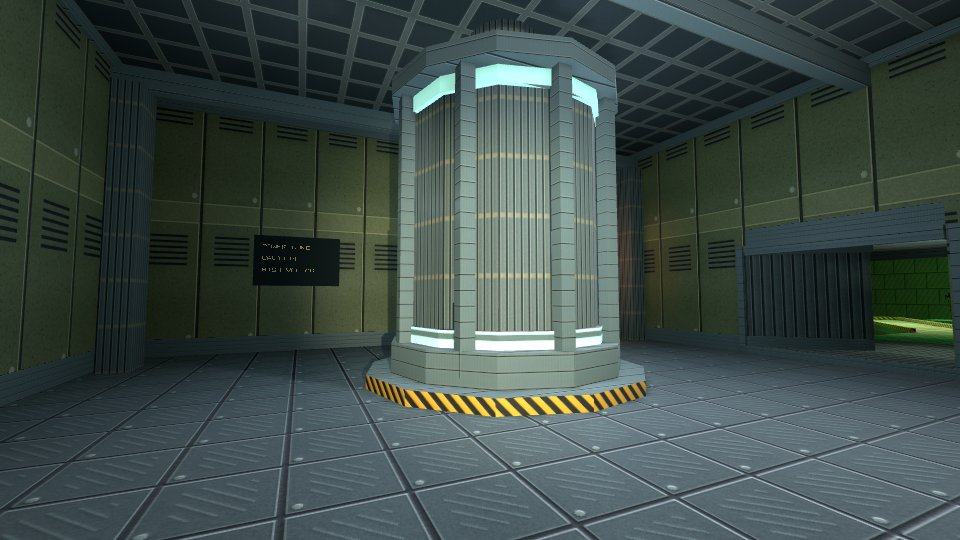

# Hangar

Explore an industrial complex of tunnels, machinery and glowing acid pools.
The sample brings together first-person movement, physics, lighting, particles
and spatial audio in a connected 3D level.



[Play](https://karty-game.github.io/karty/main/hangar/) · [All samples](../README.md)

## Try it

Use **WASD** to walk and **Shift** to run. Click to look with the mouse;
**Escape** releases it. **F** toggles the torch. On touch screens, use the two
joysticks. Push crates, ride the elevator and use **Camera** to jump to landmarks.

## Built with

- [3D Controllers](https://karty-game.github.io/karty-packages/packages/controllers-3d.html): first-person movement, mouse look and touch controls.
- [Go YAML](https://github.com/yaml/go-yaml): prepares particle effects from their recipes.
- [go-toml](https://github.com/pelletier/go-toml): reads level asset lists when preparing effects.

## Run locally

[Set up the CLI](../README.md#run-a-sample), then from the repository root:

```sh
cd samples/hangar
../../dist/karty dev
```

Explore [the game](src/main.go), [scene](src/scene.go) and [level](levels/hangar/world.yaml).

## Fixed lighting candidate

This sample targets SDK **0.0.21** and enables `fixed = true` in its chunked
offline lightmap recipe. SDK 0.0.21 is currently a local release candidate;
install its checksummed bundle before building. Use a matching candidate host
with `karty build --host /path/to/host/webgpu --target web`.

The WebGPU build prepares the environment materials as KTX2 UASTC + Zstandard
arrays with generated SSBump and complete mip chains. Supply the complete
browser host bundle directory so its texture decoder and license files are staged.

Static geometry is grouped into nine room-scale render chunks. Build-only
`room_groups` keep stairs, recesses and access rooms with their surrounding area;
eight-metre catalog coordinates bound chunks without cutting the rooms. Each KLD
carries final GPU buffers and its own three-layer lossless RNM KTX2. Portal
traversal selects these chunks; grid neighbors do not imply reachability.
Physical ownership and lighting probes remain separate. Water normals, flow and
wave parameters are prepared offline.

Steady lamps and ambient fill share one fixed bake. Moving crates use chunk
probes and soft receiver shadows; the camera torch stays a runtime light.
The folded corridor keeps flashlight depth shadows disabled. Chunk pages use
eight texels per metre, 64 transport samples and low denoising to retain fixture
and contact detail. Pages grow only as needed, up to 1024 pixels, at unchanged
density and padding.

`karty build` produces the required chunk bakes. Rebake after changing the
authored geometry, materials or static lighting.

## Visual assets

The surface, machinery, wayfinding and floor-residue generators live in
[`scripts/`](../../scripts/). From the repository root, regenerate them with
`mise run generate-hangar-materials`, `mise run generate-hangar-heroes`,
`mise run generate-hangar-wayfinding` and `mise run generate-hangar-contact`.
Each has a corresponding `check-hangar-*` task that verifies reproducibility.
The machinery generator owns the marked fittings blocks in `world.yaml`.

The acid base uses broad flow variation; animated particles supply its bubbles.
Static signs have larger lettering and dedicated steady panel lights. Localized
soot and service grime sit beneath fixed equipment, while moving crates retain
the runtime's receiver-projected shadows. After rebuilding chunk lighting, use
`karty render reflections levels.hangar --host /path/to/karty-host` to refresh
the saved reflection environments, then rebuild the distribution.
