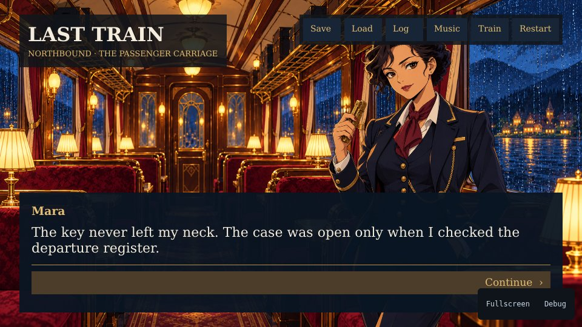

# Last Train

A short 1930s railway mystery with anime characters, three endings and
independent run slots. Question Mara, the conductor; Elias, the retired
signalman; and Iris, the blonde traveller with round glasses. Clues and trust
change the choices available in the dining car.



[All samples](../README.md) · [Story source](dialogue/story.yarn) · [Dialogue package](../../packages/dialogue/README.md)

## Run it

Complete the [sample setup](../README.md#run-a-sample), including
SDK 0.0.14 and its matching host, then run from the CLI repository root:

```sh
mise run build-last-train-web
mise run serve-last-train
```

Character reveal uses `UI.Reveal` from SDK 0.0.14. Build from this checkout,
which pins KartUI v0.0.8 with its `reveal` compiler support. The CLI installs the
matching SDK and host; `KARTY_HOME` selects their cache directory.

The first build also installs the pinned .NET SDK for the Yarn compiler.

## Controls

Choose **Begin the journey** on the title screen. The prologue introduces the
station, your arrival and the conductor before the investigation.

| Control                             | Action                                                            |
| ----------------------------------- | ----------------------------------------------------------------- |
| Click/tap the scene or advance icon | Finish revealing the current line, then advance on the next press |
| Dialogue option                     | Choose a response                                                 |
| Slot                                | Cycle through three independent run slots                         |
| Save / Load                         | Store or restore the selected run                                 |
| Log / Escape                        | Open or close conversation history                                |
| Music / Train                       | Toggle the score or ambience and save the preference              |
| Restart                             | Return to the title, preserving preferences, unlocks and slots    |
| Tab / Enter                         | Focus and activate UI controls                                    |

Saves persist on the same browser origin or native user account. Reached
endings unlock in a shared profile; loading an older run preserves those unlocks
and current preferences.

## Story and saves

This sample uses SDK/host **0.0.14** (API **0.0.12**) for character
reveal and persistent saves, plus the `dialogue` package and optional save storage:

| Package                                       | Responsibility                                                                 |
| --------------------------------------------- | ------------------------------------------------------------------------------ |
| [dialogue](../../packages/dialogue/README.md) | Official Yarn compiler, portable runtime, presentation model and ready-made UI |
| [savegame](../../packages/savegame/README.md) | Arbitrary profile bytes and independently saved run slots                      |

Story source is [dialogue/story.yarn](dialogue/story.yarn). It demonstrates
conditional choices, variables, stable line IDs, custom scene/portrait/audio
commands, expressions, group staging, gestures and three endings. The game combines a validated Yarn snapshot with
the run presentation snapshot, then stores opaque bytes through the engine.
The complete checkpoint, including its envelope, is limited to 48 KiB.
Checkpoints include recent dialogue history and presentation state, so they may
use a few kilobytes; they do not contain cartridge assets or runtime memory.
Profile data uses a separate key. The sample owns both payload formats; neither
the engine nor the savegame package requires a schema or version. The original
single `checkpoint` remains readable in slot 1; subsequent saves use `run_1`. Its
stable identity is `com.karty.samples.last-train`. Save errors appear in the
dialogue panel and leave the current session intact.

## Presentation

Characters change expression and hand/prop poses at authored beats, including
Iris offering the envelope, Elias reading the letter and Mara touching her key.
Desktop staging adds eased
entrances and exits, steady single-character framing, short nod/recoil/reach reactions, a dining
tableau and platform rain. Painted station and carriage backgrounds keep a fixed
position, scale and rotation; there are no moving rectangle light overlays.
Phone presentation uses a stable portrait container, expression changes, group portraits
and sliding entrances; continuous ambience and gesture movement are currently
desktop-only. The title's Motion button selects reduced motion and remembers
that preference independently of run saves.
Scene changes use a brief cinematic curtain and chapter card. Rainy platforms
leave room for the score; the rolling-train ambience begins aboard the carriage.

Narration has no speaker label and uses a warm italic serif face. Dialogue uses
regular sans-serif type with a nameplate. Before introductions, nameplates and
history use Conductor, Older passenger or Traveller; Yarn variables remember
introductions per run. Choice labels also avoid revealing unknown names. The
advance control uses `»` during reveal and `▾` when ready. Text appears character
by character while the renderer retains the complete line’s wrapping, shaping
and alignment. Already visible glyphs stay fixed; the first activation finishes
the line and the next advances it.

## Art and audio

The original score, **Last Carriage**, uses sampled acoustic piano, clarinet,
upright bass, nylon guitar and brushes in a gently swung 32-bar foxtrot.
The [editable score and rendering instructions](assets/audio/README.md) retain
instrument credits. It is a new composition, not an archival recording.
The rail rhythm, ticket punch and whistle come from
[the Foley source](../../scripts/last-train-audio.go). Generated artwork,
expression references and prompts are documented in the
[art provenance](assets/art/README.md). DejaVu font licensing is retained in
`assets/fonts/LICENSE.txt`; the italic narration face retains its separate
Liberation notice in `assets/fonts/Liberation-LICENSE.txt`.

## Checks and native packaging

Run these tasks from the CLI repository root:

```sh
mise run build-last-train-native
mise run test-dialogue-packages
mise run check-last-train-web
mise run check-last-train-pacing
mise run check-last-train-direction
```

The build tasks select .NET SDK 9.0.203 for Yarn Spinner 3.2.1; the first build
restores its locked NuGet dependencies. The package compiler runs only because
this consumer explicitly selects `dialogue.compile` in `karty.toml`. Regenerate Foley
with `mise run generate-last-train-audio`; the score has separate
[rendering instructions](assets/audio/README.md). Regenerate compiler fixtures
with `mise run generate-yarn-fixtures`.

See the [dialogue compatibility reference](../../packages/dialogue/docs/yarn-compatibility.md) for the initial compatibility limits. This is a
compact sample with optional progressive text, authored pauses and scene cards.
Voice acting and translated string-table selection are future presentation
features, not implied support. Yarn checkpoints require the same compiled
program. This revised story cannot resume checkpoints from the previous draft;
lifetime preferences and unlocks are preserved.
Browser saves are local to an origin; they do not synchronize to native or
another device. Browser checks write reports and artifact hashes under
`dist/validation/last-train/`.

The dialogue package uses [binary dialogue resources and saves](../../packages/dialogue/docs/binary-runtime-v2.md).
Rebuild and start a new run when upgrading from the earlier CSV/JSON candidate;
lifetime preferences, motion settings and ending unlocks retain their format.
