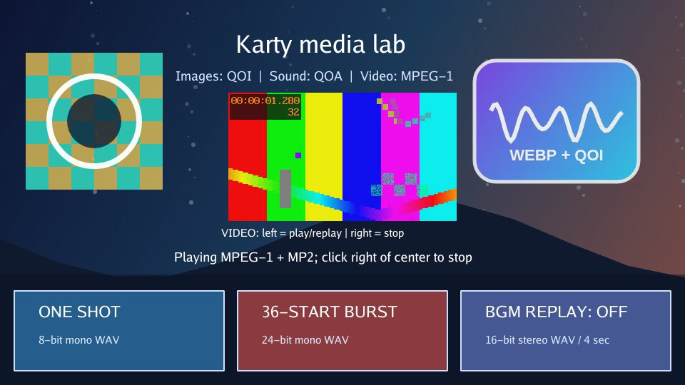

# Media lab

An interactive scene for trying images, sound and video together. It showcases
overlapping sound effects, looping music, playback controls and a layout that
adapts to smaller screens.



[Play](https://karty-game.github.io/karty/main/media-lab/) · [All samples](../README.md)

## Try it

Click or tap to enable audio. **ONE SHOT** plays a sound; **36-START BURST**
layers many at once. **BGM REPLAY** fades looping music in or out. Use the
video's **Play / replay** and **Stop** controls to try video with sound.

## Built with

- [KartUI](https://github.com/karty-game/karty-ui): playback controls and responsive layouts.

## Run locally

[Set up the CLI](../README.md#run-a-sample), then from the repository root:

```sh
cd samples/media-lab
../../dist/karty dev
```

Explore [the game](src/main.go), [UI layouts](ui/) and [sound sources](sound-sources/README.md).
