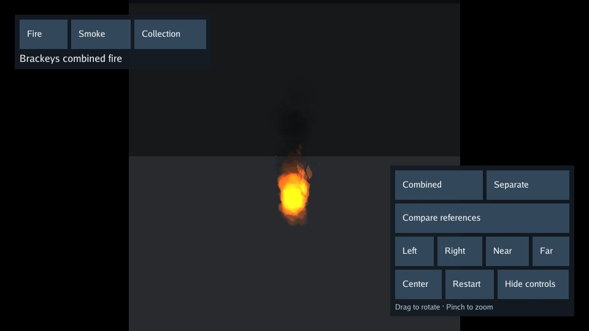

# Particle lab

A gallery of fire, smoke, sparks, acid, electrical effects and explosions.
Compare reusable particle effects in a plain room so their motion, color and
shape are easy to see.



[Play](https://karty-game.github.io/karty/main/particle-lab/) · [All samples](../README.md)

## Try it

Choose **Fire**, **Smoke** or **Collection**, then select an effect. Drag to
rotate and pinch to zoom, or use the on-screen controls. **Restart** replays
the effect; **Center** resets the view. Hide the controls for a clearer look.

## Built with

- [Brackeys VFX Bundle](https://brackeysgames.itch.io/brackeys-vfx-bundle): CC0 fire textures and reference effects.
- [CloudKid artwork](effects/sources/LICENSE-PARTICLES.txt): MIT-licensed fire artwork.
- [Go YAML](https://github.com/yaml/go-yaml): assembles effect recipes and demonstration rooms.

## Run locally

[Set up the CLI](../README.md#run-a-sample), then from the repository root:

```sh
mise run build-particle-lab-web
mise run serve-particle-lab
```

Open the address printed in your terminal.
Explore [the game](src/main.go) and [effect recipes](effects/).
