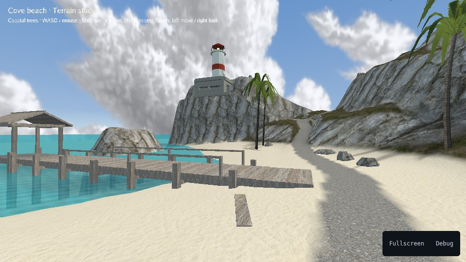

# Terrain: coastal cove

Explore a tropical beach, follow trails to a cliff bunker and lighthouse, or
swim beneath the ocean. This sample shows outdoor terrain, vegetation,
first-person exploration and underwater effects.



[Play](https://karty-game.github.io/karty/main/terrain/) · [All samples](../README.md)

## Try it

Use **WASD** to walk and **Shift** to run. Click to look with the mouse;
**Escape** releases it. **Space / C** rises or dives while swimming. On touch
screens, use the two joysticks. **V** cycles landmarks and **R** returns to the beach.

## Built with

- [3D Controllers](https://karty-game.github.io/karty-packages/packages/controllers-3d.html): first-person movement, mouse look and touch controls.

## Run locally

[Set up the CLI](../README.md#run-a-sample), then from the repository root:

```sh
cd samples/terrain
../../dist/karty dev
```

Explore [the game](src/main.go), [explorer](src/explorer.go) and [landscape](levels/ground/world.yaml).
