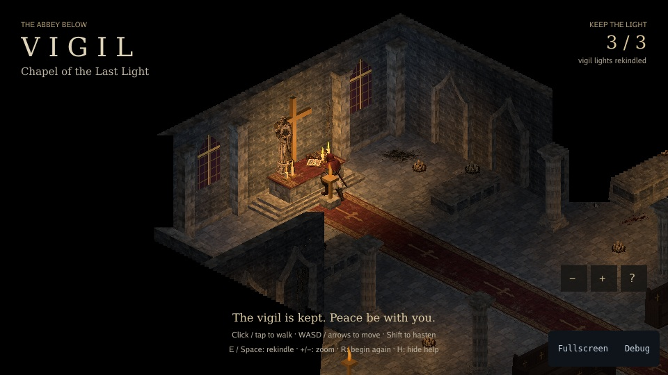

# Vigil — the abbey below

Explore a candlelit abbey crypt and rekindle three vigil lights. Vigil shows
isometric exploration with animated characters, obstacle-aware navigation,
camera follow and atmospheric lighting.



[Play](https://karty-game.github.io/karty/main/vigil/) · [All samples](../README.md)

## Try it

**Click / tap** the floor to walk, or use **WASD / arrows**. Approach a vigil
light and press **E / Space**, or tap it, to rekindle it. **F** throws a
fireball, **R** restarts, and **Camera settings** lets you adjust the following camera.

## Built with

- [Isometric Controllers](https://karty-game.github.io/karty-packages/packages/controllers-isometric.html): movement, pointer targeting and camera follow.

## Run locally

[Set up the CLI](../README.md#run-a-sample), then from the repository root:

```sh
cd samples/vigil
../../dist/karty dev
```

Explore [the game](src/main.go), [navigation](src/navigation.go) and [crypt](levels/crypt/).
