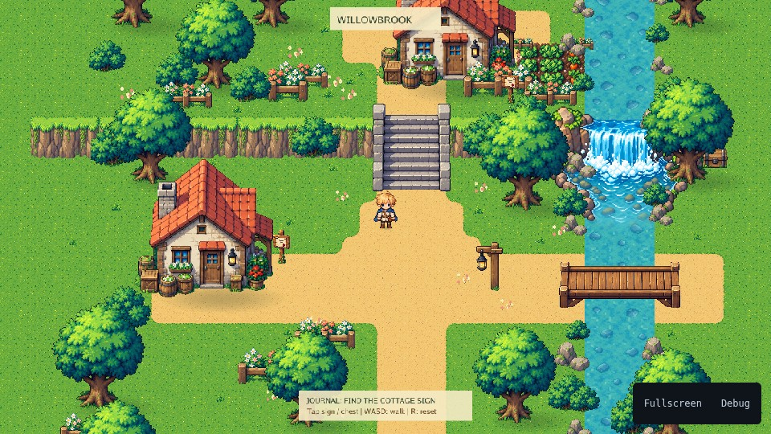

# Willowbrook

A small sunny treasure hunt, authored in Tiled and rendered by Karty's ordinary
Ebiten 2D sprites. Follow the cottage note, explore the garden up the stone
steps, and find the hidden cache across the bridge.



WASD or arrows walk; Shift runs. Tap the ground to stroll directly toward it.
Tap a note or cache to find a walkable route and inspect it, or approach with
the keyboard and press E or Space. R restarts the hunt. Losing focus cancels
held input and automatic walking.

Noticeboards show a nearby **READ [E]** prompt, and the chest shows **OPEN [E]**.
Tap the painted sign face, nearby prompt or highlighted journal action; the
character approaches through the same collisions before reading. E/Space also
reads a nearby item. The journal stays compact at the bottom during play; tap
its title to reopen it, or use E/Space, Escape or CLOSE to dismiss a page.

From the CLI repository root:

```sh
mise run author-willowbrook
mise run check-willowbrook
mise run build-willowbrook-web
mise run serve-willowbrook
```

The sample uses SDK 0.0.13 with Camera2D and its matching public host.
No engine source is imported by the sample. `KARTY_HOST_WEB` selects a contributor
host override; native packaging uses `mise run build-willowbrook-native`.

## Edit the level

Open [internal/village/village.tmj](internal/village/village.tmj) in Tiled 1.11
or later. Its external image collection is [internal/village/village.tsj](internal/village/village.tsj).
Run asset authoring first if the tile PNGs are absent.

- Ground and Paths contain ordinary resolved tile IDs. The corner terrain brush
  uses the approved grass tile plus fifteen nonempty dirt configurations.
- River and Terrain details hold visible terrain and intact structures. The
  legacy Bridge deck layer is empty; it contributes no extra plank strips.
- Riverbed sits below the translucent River surface. Ground shadows and grass
  are separate editable layers; they do not alter collisions or quest routes.
- Scenery contains bottom-anchored image objects, sorted by their feet. The hero
  joins this same drawing band, so trees and cottages occlude it naturally.
- Collision contains authored rectangles and polygons for every visible rock
  cluster, house body, tree roots and stone stair cheeks. `playerRadius` and
  `playerRadiusY` describe a 14×10 foot ellipse, keeping soles outside stone
  while preserving the narrow stair landing.
- Gameplay contains the spawn, two clues, treasure, and named traversal areas.
  Custom properties hold clue order and text. Map properties hold camera zoom,
  follow offset, movement speeds and character dimensions.

Changing a house, path, collision or clue requires editing the map. Ordinary
asset generation and builds preserve the TMJ and TSJ. There is no scene-placement
generator in the game: the map itself owns every tile and object position.

The map includes painted ground beyond the village's collision boundary so
camera following stays filled in portrait, desktop and landscape views up to
2.5:1. Portrait keeps the same vertical view and follows the hero through a
narrower horizontal slice. The quest panel stays in the central HUD safe area.

## Rendering with the reusable Tiled package

[The shared parser](../../packages/tiled/README.md) reads a documented subset of Tiled JSON:
finite orthogonal maps, array tile data, external JSON tilesets, image collections
and regular atlases, groups, offsets, visibility, opacity, tile flips and
bottom-anchored tile objects. The loader has no Karty or village dependency.
Unsupported map orientation, image layers and collision shapes return errors.

The staircase and bridge each use one complete, uniformly scaled sprite.
Their foreground masks copy pixels from the same image, using editable
`foreground` rectangles/polygons in the tile's Tiled object group. The matching
base/front image objects share a pose; the foreground joins the hero's sorted
scenery band so stone cheeks and front posts cover the correct parts of it.
Move the base, matching foreground and collision objects together when editing.
`check-willowbrook` checks their alignment. Regeneration does not replace them
with tread or plank strips.

The asset importer derives atlas rectangles from tileset dimensions, spacing
and margins. The cartridge resolves image keys to bundled textures and uses
`NewLevelSprite2D` and `Transform2D`. No handwritten UV coordinates or 3D world
geometry appear in the renderer. The camera uses `SetCamera2D`; pointer input
uses its matching `ScreenToWorld` helper. Static tile transforms are sent once.
The view creates/removes sprites in bounded batches as the camera moves, using
complete image bounds and an overscan area.

Water, tree foliage and loose flowers use standard [Tiled tile animation](https://doc.mapeditor.org/en/stable/reference/json-map-format/#frame)
with tileset-local frame IDs and millisecond durations. The importer includes
frames even when no map cell places them directly. A shared map clock preserves
phase when sprites enter the view. Trees keep their trunk/root pixels fixed;
only the foliage changes. Water keeps its footprint fixed above the riverbed.

Shallow grass/earth banks use a transparent paired image in the Tiled `River banks`
layer. They cover the flat grass/water edge, join beneath the intact waterfall
and bridge, and continue through the camera buffer. The bridge's water opening
allows the player to use the visible plank depth; all four support posts remain
solid. Planned routes reserve 0.25px extra clearance so they avoid numerically
tangent post corners without reducing the physical walking area.

Grass uses custom tile properties `windAmplitude` (degrees) and `windPeriod`
(seconds), interpreted by this adapter as a gentle rotation around the root.
These properties are sample conventions. They are not a built-in Tiled wind
feature. Soft contact shadows ground props and follow the character's soles.

Character animation advances with actual distance, using the map properties
`heroWalkStride` and `heroRunStride` for pixels per four-pose cycle. Defaults of
64 and 80 give roughly 6.8 walking and 8.8 running pose changes per second at
the authored speeds. Idle and collision stops return to a neutral pose.

The parser, image importer and sprite presentation now live in the reusable
[`tiled` package](../../packages/tiled/README.md), version `0.1.0`. This sample
imports it through `[packages.tiled]` in `karty.toml`; its generated SDK backend
only creates, updates and destroys ordinary `Sprite2D` entities. Collision,
treasure gameplay and artwork preparation remain game-owned. The shared package
contains no generated engine bindings or hand-coded texture UV coordinates.

A [second independent Go consumer](../../testdata/tiled-room/README.md) uses a
non-square atlas, all eight flip combinations, standard Tiled animation,
continuous camera movement and portrait touch. Willowbrook uses TinyGo. The
package can be linked as a folder during development or exported/imported as a
`.kpkg` archive. See its README for supported Tiled features, limits and backend
integration. It is a local candidate; no registry release has been published.

## Validation

```sh
mise run check-willowbrook
mise run check-willowbrook-web -- --art
mise run check-willowbrook-web -- --portrait
mise run check-willowbrook-web -- --quest
mise run check-willowbrook-web -- --structures
mise run check-willowbrook-web -- --bridge
mise run check-willowbrook-web -- --motion
mise run check-willowbrook-web -- --collision-house
mise run check-willowbrook-web -- --collision-tree
mise run check-willowbrook-web -- --collision-terrain
mise run check-willowbrook-web -- --interactions
```

The browser checker passively observes normal submitted commands. It verifies
zero 3D commands/views, bounded batches, camera follow, ordered clue interaction,
cache opening/restart, focus cancellation, touch and a live framebuffer. The
portrait fixture checks 390×844, landscape rotation and return. The structure
fixture walks beside the stair cheeks and behind/across/in front of the bridge,
capturing the actual sprite overlap at 2560×1440. Each fixture has
a separate 120-second deadline. Captures use Chromium SwiftShader at full scale
with synthetic input; they do not qualify physical devices or FPS. Reports and
screenshots go to `dist/validation/willowbrook/`. The motion fixture records eight
sequential ambient frames and passively verifies actual frame swaps, slower
walk/run cadence, idle stillness and the character's contact-shadow position.
Separate house/tree collision fixtures use sustained real input from all four
sides, including passage behind the roof/canopy. The house fixture also checks
diagonal sliding at the annex. Native regressions cover the solid body and root
areas of every authored house/tree footprint and the complete quest routes.
The bridge fixture drives both landings, both off-center plank lanes in either
direction, rail stops and diagonal deflections using actual held input.

For checks during concurrent authoring, use
`mise run build-controllers-willowbrook-snapshot` and set
`KARTY_WILLOWBROOK_PROJECT` to its printed frozen directory.
`KARTY_WILLOWBROOK_OUTPUT` selects a separate reports/captures directory.
The checker then uses the snapshot's map, texture metadata and distribution
together instead of observing frozen game bytes with live asset IDs.

The official Tiled editor/rasterizer also opens, exports and renders the TMJ.
See [art sources and prompts](../../scripts/willowbrook/assets/README.md).
Retained source sheets live with the contributor tools; runtime PNGs stay in
`levels/village`. The map, tileset and `map.generated.json` stay together in
`internal/village`, including in frozen browser-check snapshots.

## Reusable controller

This sample uses the [top-down 2D preset](../../packages/controllers/README.md)
from the shared `controllers` package. Input state and camera calculations are
portable; this game owns its SDK adapter, entities and gameplay. Normal builds
restore the declared package automatically.

Map JSON is a build input selected by `tiled.compile` in `karty.toml`. The
processor emits binary `.karty/processed` resources; the cartridge decodes KTM1
records and does not embed the editable map or tileset. Source edits rebuild
these resources during normal `karty build` and `karty dev`.
