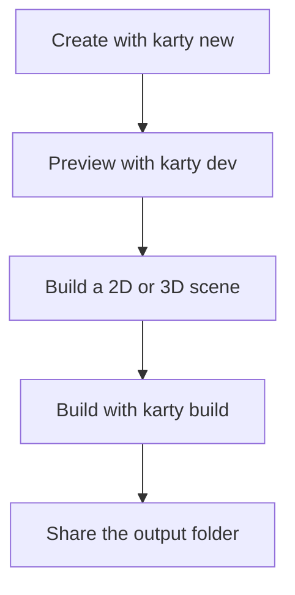

## Start with a playable game

Install the [Karty CLI](https://github.com/karty-game/karty/releases/latest), then run:

```sh
karty new my-game
cd my-game
karty dev
```

The terminal wizard offers `blank`, `2d`, `fps`, `isometric`, and `ui`, plus optional
Git initialization and GitHub Actions. Use `--yes --template 2d` for scripts.
Use `--no-template` for just the base folders and an empty entry point.
The 2D, first-person and isometric starters include their controller plugins.
The [first-person starter](fps.html) provides walking, physics and touch controls.
Blank and UI projects add controls only when needed.

Open the address printed by the preview. Change a color or a movement speed in
`src/main.go`, save, and try it again. The first setup downloads tools; later
builds reuse them.



Keep `karty.toml`, your Go source, and source assets in Git. The CLI recreates
`.karty/` and `dist/`. Use your project's `.karty/docs/`
reference for API names and supported features.

New projects also include the [Karty game development agent skill](https://github.com/karty-game/karty/tree/main/skills/karty-game)
in `.agents/skills/karty-game/`. Agents that support project skills can discover
it there; invoke `$karty-game` when your agent supports named skills. It explains
asset and level organization, Go and KartUI capabilities, commands and validation.
Keep this guidance with your game's source if your team uses it. It is copied
from the CLI at creation and is not overwritten by builds or updates;
the game's generated `.karty/docs/` remains authoritative for its API.
For an existing game, copy the repository's `skills/karty-game/` directory into
its `.agents/skills/` directory after reviewing any existing guidance. Review
future skill updates deliberately; there is no automatic skill update command.

Make one small game rule work before adding more art: collect an item, reach a
goal, or restart after losing. For a 3D game, choose the first-person or isometric starter, then extend its
room using the matching guide path. [Hangar](../hangar/)
shows first-person exploration and connected rooms in a larger world.
