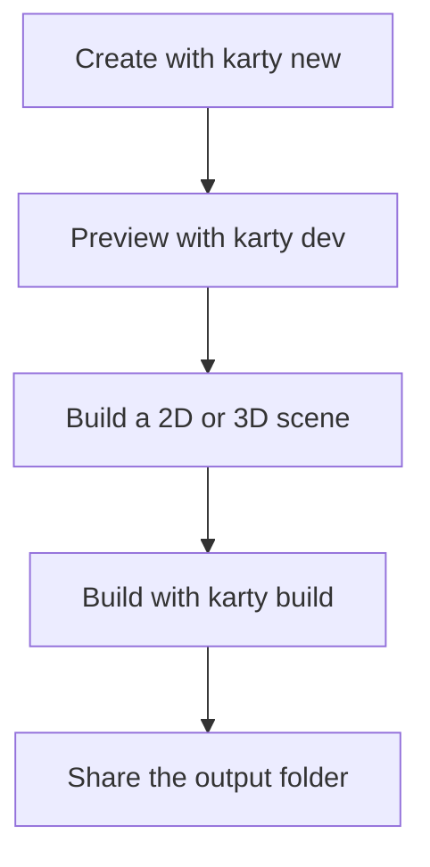

## Start with a playable game

Install the [Karty CLI](https://github.com/karty-game/karty/releases/latest), then run:

```sh
karty new my-game
cd my-game
karty dev
```

The terminal wizard offers `blank`, `2d`, `fps`, `isometric`, and `ui`, plus optional
Git initialization and GitHub Actions. Use `--yes --template 2d` for scripts.
Use `--no-template` for just the base folders and an empty entry point.
Current starters use SDK 0.0.13, which the CLI installs when needed.

The SDK 0.0.13 2D, first-person and isometric starters use one reusable
controllers package with different presets. They include its source under
`packages/controllers/` so generated projects work without a published module.
Keep that folder in Git. Blank and UI projects add controls only when needed.

Open the address printed by the preview. Change a color or a movement speed in
`src/main.go`, save, and try it again. The first setup downloads tools; later
builds reuse them.



Keep `karty.toml`, your Go source, and source assets in Git. The CLI recreates
`.karty/` and `dist/`. Your project pins an exact SDK; use its `.karty/docs/`
reference for API names and supported features.

Make one small game rule work before adding more art: collect an item, reach a
goal, or restart after losing. For a 3D game, choose the first-person or isometric starter, then extend its
room using the matching guide path. [Roman court & galleries](../world-camera/)
shows how those camera views work in a larger world.
