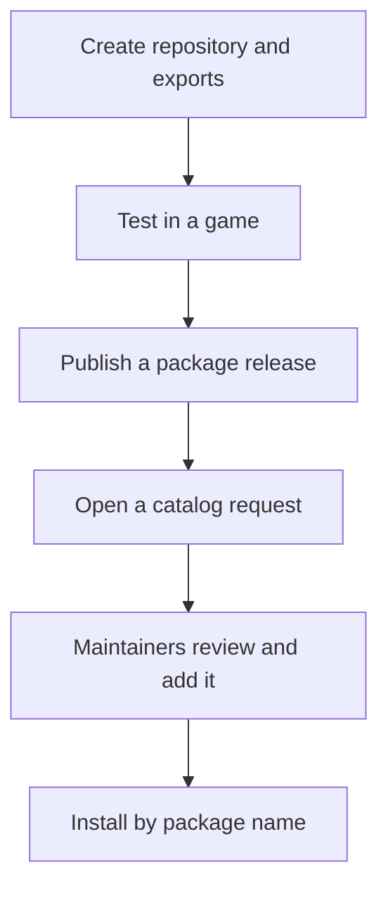

## Write and publish a package

Keep your package in its own public GitHub repository. The catalog links to your releases.



### Create the repository

Example: `your-name/community-props`, with the package at the repository root:

```text
community-props/
  karty-package.toml
  README.md
  LICENSE
  textures/crate.png
  screenshots/props.png
```

- `README.md`: purpose, install command, usage example and screenshot.
- `LICENSE`: terms for the code and assets; include any third-party notices.
- `textures/crate.png`: an original PNG texture, exported by the manifest below.
- `screenshots/props.png`: a preview for the catalog.

Create `karty-package.toml`:

```toml
format_version = 1
name = "community-props"
version = "0.1.0"

[[textures]]
name = "crate"
source = "textures/crate.png"
profile = "environment"
```

Use a unique package name and a full `major.minor.patch` version. Source paths are
relative to the package root. This exports `community-props.crate` to games.

Packages can also export Go code (`go.mod`), prefabs (`prefabs`), UI (`[ui]`) and
build processors (`[[processors]]`). See [package exports](../design/packages.html).

### Test in a game

From a game project beside the package repository:

```sh
karty package import ../community-props
karty dev
```

Use the exported texture in a level and check the result.

### Publish a release

From the package repository root:

```sh
mkdir -p dist
karty package export --output dist/community-props-0.1.0.kpkg .
```

Keep `dist/` out of Git. Commit and push the sources, then create a published
GitHub release with:

| Field            | Value                                                                 |
| ---------------- | --------------------------------------------------------------------- |
| Tag              | `community-props-v0.1.0`                                              |
| Attached archive | `community-props-0.1.0.kpkg`                                          |
| Checksum         | GitHub's SHA-256 asset digest, or `community-props-0.1.0.kpkg.sha256` |

A checksum file contains `<sha256>  community-props-0.1.0.kpkg` on one line;
export prints the archive's SHA-256. The manifest, tag and archive versions must
match. Use a stable release; drafts and prereleases are excluded from the catalog.
Publish a new version for changes; keep existing releases unchanged.

### Request a catalog listing

[Open an issue in karty-packages](https://github.com/karty-game/karty-packages/issues/new)
titled `Add package: community-props`. Include the release link, license and this
catalog entry, replacing `your-name`:

```json
{
  "name": "community-props",
  "repository": "your-name/community-props",
  "description": "Prototype crates and materials",
  "tags": ["3d", "prototyping"],
  "source": ".",
  "ref": "main",
  "readme": "README.md",
  "preview": "screenshots/props.png"
}
```

Maintainers review the request and, if approved, add it to `catalog.json`.
Your sources and releases stay in your repository. After the catalog is published:

```sh
karty package import community-props
```

Later stable releases are discovered during catalog refreshes. Existing users
update explicitly with `karty package upgrade community-props`.
